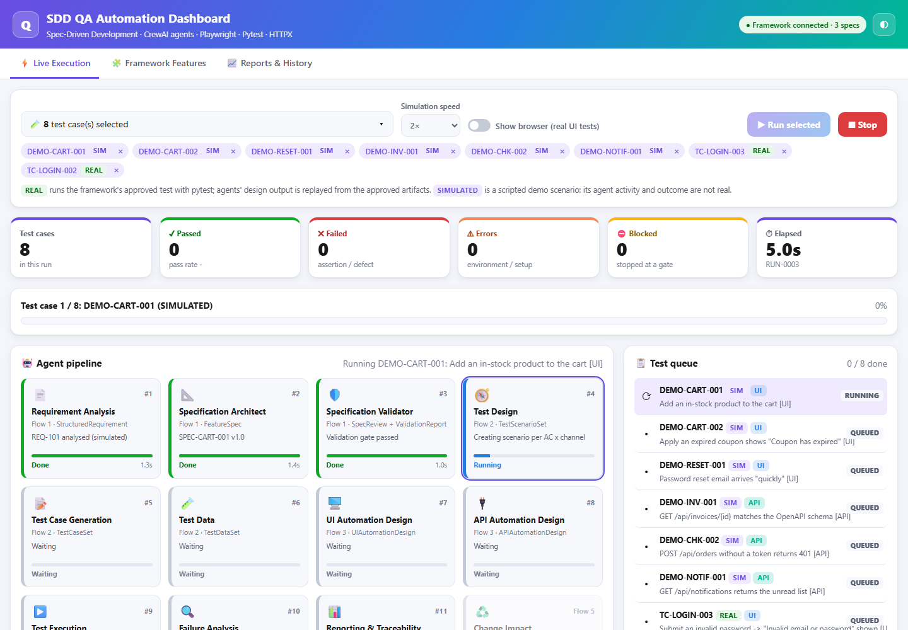
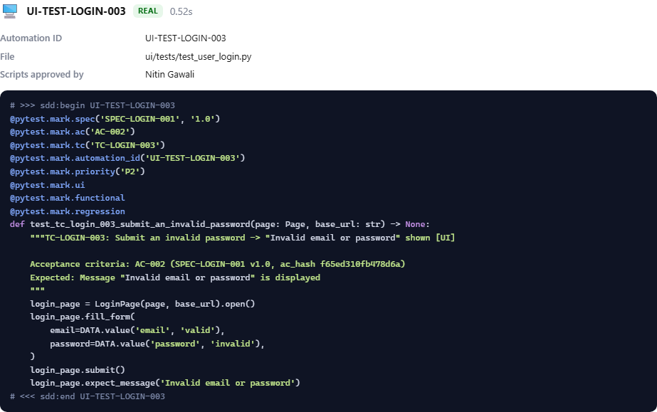
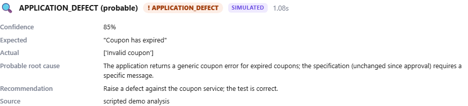

# SDD QA Automation Dashboard

An interactive web dashboard for the **SDD-Based AI QA Automation Framework using CrewAI**
(`../qa-sdd-crewai-framework`). Pick test cases, press **Run**, and watch each one move through the framework's
AI agents live: status, activity, progress, output, logs, results and a summary report.



## Real vs simulated: read this first

The framework's core rule is *no fabricated results*, so the dashboard labels every test case:

| Label | What runs | Where the result comes from |
|---|---|---|
| **REAL** | An approved test case of the framework (e.g. `TC-LOGIN-003`). The design-time agents (analysis → automation design) ran when the artifacts were created; their recorded output is **replayed from the approved artifacts**. The Test Execution stage **really runs pytest** in the framework (Playwright / HTTPX against the demo app). | The framework's pytest plugin. Failures are classified with the framework's own rules (`generators/analysis.classify`). |
| **SIMULATED** | A dummy demo scenario (cart, checkout, search, billing, …). Agent activity, timings and outcome are **scripted**. | Scripted. Designed to show every path: pass, application defect, automation issue, spec drift, test data issue, environment error, and a spec blocked at the validation gate. |

## Features

**Live Execution tab**
- **Test case picker**: multi-select dropdown with search, grouped by feature, REAL/SIMULATED and UI/API tags,
  and presets (*Showcase mix*, *All simulated*, *All real*, *Real UI only*).
- **Run controls**: simulation speed (0.5×–3×), *Show browser* (headed Chromium for real UI tests), Run and Stop.
- **KPI tiles**: total, passed, failed, errors, blocked, pass rate and elapsed time, updated live.
- **Agent pipeline**: one card per agent (12 in total; Change Impact belongs to Flow 5). Each card shows its
  state (waiting / running / done / failed / blocked / skipped), current activity, progress bar and duration.
- **Agent output**: click any agent card to see what it produced for the selected test case: Given/When/Then,
  validation findings and approvals, test steps, test data expressions, the **real generated code region**, the
  pytest outcome, the failure classification and the traceability chain.
- **Test queue**: every test case with live status; click one to inspect its pipeline.
- **Live log**: colour-coded and filterable by level, agent and text, with follow mode.
- **Charts**: outcomes, time per agent, and a failure analysis table.
- **Summary report** at the end of each run, downloadable as JSON (also saved in `runs/`).

**Framework Features tab**: SDD principles, the lifecycle diagram, the 12 agents (role and goal read from the
framework's `config/agents.yaml`), the 5 flows with copyable commands, gates and safety controls, LLM providers, and
a **real snapshot** of the framework's specifications, approvals and validation status.

**Reports & History tab**: history of dashboard runs, and the framework's own `EXEC-*` executions (real), each
with a chart and a table.

| Agent output: real code region | Agent output: failure analysis |
|---|---|
|  |  |

## Run it

Prerequisite: the framework is installed (its `.venv` exists, Playwright Chromium installed). The dashboard
reuses that virtual environment, so nothing else needs installing. It finds the framework automatically: as its
**parent folder** (this folder inside the framework repository) or as a **sibling** folder named
`qa-sdd-crewai-framework`.

```powershell
cd Dashboard-qa-sdd-crewai-framework
.\run.ps1                 # starts the server and opens http://127.0.0.1:8090
```

or manually, from inside the framework repository:

```powershell
cd Dashboard-qa-sdd-crewai-framework
..\.venv\Scripts\python.exe server.py
# then open http://127.0.0.1:8090
```

| Setting (environment variable) | Default |
|---|---|
| `SDD_FRAMEWORK_DIR` | parent folder if it is the framework, else `../qa-sdd-crewai-framework` |
| `DASHBOARD_PORT` / `DASHBOARD_HOST` | `8090` / `127.0.0.1` |

Charts and the diagram load Chart.js and Mermaid from public CDNs, so the browser needs internet access for those.

## Demo script (5 minutes)

1. **Framework Features** tab: explain *spec is the source of truth*, the lifecycle, the 12 agents and the 3 human gates.
2. **Live Execution**: the *Showcase mix* is preselected (6 simulated + 2 real). Press **Run selected**.
3. While it runs, click agent cards to show each agent's output. Point out:
   - `DEMO-RESET-001` stops at the **Specification Validator** (vague "quickly"); every later agent is skipped;
   - `DEMO-CART-002` fails, and the **Failure Analysis** agent classifies it as `APPLICATION_DEFECT`;
   - `DEMO-INV-001` is `SPEC_IMPLEMENTATION_DRIFT`, `DEMO-NOTIF-001` an `ENVIRONMENT_ISSUE`;
   - `TC-LOGIN-003` is **REAL**: the log shows actual pytest output, and the UI design card shows the real code.
4. Tick **Show browser** and run `TC-LOGIN-001` to watch Playwright drive the login page.
5. Show the **Summary report** and the **Reports & History** tab.

## Project layout

```text
Dashboard-qa-sdd-crewai-framework/
├── server.py                 FastAPI app: REST API + server-sent events stream
├── dashboard/
│   ├── config.py             paths (framework location, runs folder, port)
│   ├── catalog.py            agents, flows, real test cases, framework snapshot (read-only)
│   ├── demo_scenarios.py     the simulated sample scenarios
│   └── pipeline.py           live pipeline runner (replay + real pytest, or scripted demo)
├── static/                   index.html, css/app.css, js/app.js (no build step)
├── runs/                     run records RUN-nnnn.json + pytest logs (git-ignored)
├── docs/                     screenshots
└── run.ps1                   launcher
```

API: `GET /api/meta`, `GET /api/testcases`, `GET /api/snapshot`, `GET /api/runs`,
`GET /api/run/stream?ids=TC-LOGIN-003,DEMO-CART-001&speed=1&headed=false` (event stream),
`POST /api/run/{run_id}/stop`.

The dashboard never writes into the framework's specifications or approvals. Real pytest runs write their results
and logs into `runs/<RUN-id>/`, not into the framework's `output/executions`.
