# FLOW.md: every flow, from scratch

This guide is for someone who has just cloned the repository and wants to understand **what happens, in what
order, and why**. It follows one feature (*User Login*, `REQ-001`) from a plain Markdown requirement to executed,
traced, reported tests. Then it shows how a specification change ripples through the system.

For the reference material (architecture, agents, configuration, commands) see [README.md](README.md).

---

## Contents

- [0. Mental model in one minute](#0-mental-model-in-one-minute)
- [1. Setup](#1-setup)
- [2. Key concepts you will meet](#2-key-concepts-you-will-meet)
- [3. The big picture: five flows, three human gates](#3-the-big-picture-five-flows-three-human-gates)
- [Flow 1: Specification](#flow-1--specification)
- [Flow 2: Test design](#flow-2--test-design)
- [Flow 3: Automation](#flow-3--automation)
- [Flow 4: Execution](#flow-4--execution)
- [Flow 5: Specification change impact](#flow-5--specification-change-impact)
- [4. Shortcut: `main.py run`](#4-shortcut-mainpy-run)
- [5. Writing your own requirement](#5-writing-your-own-requirement)
- [6. Where every artifact lives](#6-where-every-artifact-lives)
- [7. Behind the scenes: how a flow uses CrewAI](#7-behind-the-scenes-how-a-flow-uses-crewai)
- [8. FAQ](#8-faq)

---

## 0. Mental model in one minute

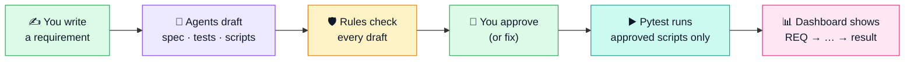

- **Agents propose, rules check, humans decide.**
- Nothing downstream ever reads an *unapproved* artifact.
- An approval is tied to the exact content (a hash). If someone edits it afterwards, the approval no longer
  counts and the flow stops.

---

## 1. Setup

```powershell
git clone https://github.com/nitingawali148/sdd-based-ai-qa-automation-framework.git
cd sdd-based-ai-qa-automation-framework
python -m venv .venv
.\.venv\Scripts\python.exe -m pip install -r requirements.txt
.\.venv\Scripts\python.exe -m playwright install chromium
Copy-Item .env.example .env
$py = ".\.venv\Scripts\python.exe"     # used in every command below
& $py main.py status
```

`.env.example` sets `LLM_PROVIDER=offline`. The agents then use a deterministic rule engine plugged into
CrewAI, so everything below works **without any API key or network** and gives the same result every time.
Switch to `ollama`, `openai` or `groq` later (README › LLM providers).

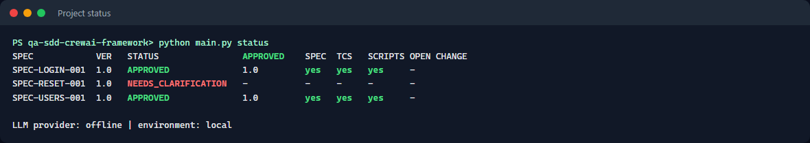

The repository already contains finished work for `REQ-001` and `REQ-002` (approved v1.0), and a deliberately
ambiguous `REQ-003`. You can follow this guide on top of that state; commands on an approved feature simply
report that the gate is already passed.

---

## 2. Key concepts you will meet

| Term | Meaning | Example |
|---|---|---|
| **Requirement** | What the business wants, written by a person | `specifications/requirements/REQ-001.md` |
| **Specification (spec)** | The structured, testable version of the requirement; the single source of truth | `SPEC-LOGIN-001` v1.0 |
| **Acceptance criterion (AC)** | One testable rule in Given/When/Then form | `AC-002`: invalid password shows "Invalid email or password" |
| **Channel** | Where an AC is verified: `ui` (browser) or `api` (HTTP) | AC-001 is `[UI, API]` |
| **Scenario (TS)** | One AC × channel × variant | `TS-LOGIN-003` |
| **Test case (TC)** | Steps, data and expected result for a scenario | `TC-LOGIN-003` |
| **Automation ID** | The generated test function's region | `UI-TEST-LOGIN-003` |
| **Execution (EXEC)** | One pytest run with verified results | `EXEC-0005` |
| **Gate** | A checkpoint: automatic (rules) or human (approval) | `spec_validation`, `human_spec_approval` |
| **Approved snapshot** | Read-only copy of what was approved | `specifications/approved/SPEC-LOGIN-001/v1.0/` |
| **Change record** | Diff + impact of a spec edit | `specifications/changes/CHG-001.yaml` |

---

## 3. The big picture: five flows, three human gates

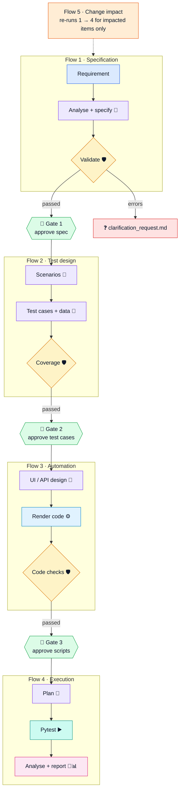

Every flow ends by printing its **status**, the **gates** it passed or stopped at, the **artifacts** it wrote,
and a line `NEXT (human)` that tells you exactly what to do next.

---

## Flow 1: Specification

**Goal:** turn a requirement written by a person into a validated, testable specification.
**Command:** `main.py spec REQ-001` · **Code:** `flows/specification_flow.py`

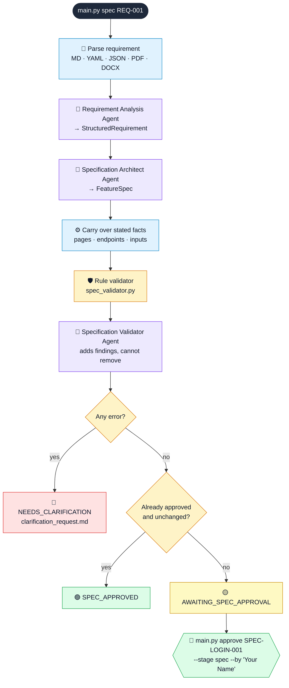

### Step by step

1. **Parse.** `parsers/requirement_parser.py` reads the front matter (`id`, `title`, `feature`, `feature_code`,
   `priority`) and sections (*User Story*, *Business Rules*, *Input Fields*, *Acceptance Criteria*, *UI*, *API*,
   *Non-Functional Requirements*).
2. **Requirement Analysis Agent** extracts everything that is stated, keeps IDs (`AC-001` …) and lists vague
   words as ambiguities. Output: `specifications/requirements/analysis/REQ-001.yaml`.
3. **Specification Architect Agent** writes one spec AC per requirement AC: Given / When / Then, input data
   classes (`valid`, `empty`, `invalid`, `too_short`, …), a measurable UI expectation (a quoted message or a
   target page) and an API expectation (status code, body text) bound to the OpenAPI contract.
4. **Facts are carried over deterministically.** Pages, endpoints and inputs stated in the requirement are copied
   into the spec, so an LLM cannot drop or rename them.
5. **Rule validation** (`validators/spec_validator.py`) is the hard gate. It checks, among others:

   | Check | Blocks when… |
   |---|---|
   | `AC_NOT_TESTABLE` | an AC is not Given/When/Then |
   | `AC_VAGUE` | words like *quickly*, *appropriate*, *user-friendly* appear |
   | `AC_UI_EXPECTATION_UNMEASURABLE` | no quoted message and no target page |
   | `AC_API_EXPECTATION_UNMEASURABLE` | an API AC has no status code |
   | `AC_API_NOT_IN_OPENAPI` | the endpoint is not in `openapi.yaml` |
   | `AC_NOT_IN_REQUIREMENT` | an AC was **invented** |
   | `AC_MISSING_FROM_SPEC` / `AC_LOST_IN_ANALYSIS` | an AC was **dropped** |
   | `AC_CONFLICT` | two ACs: same action, different expected result |
   | `OPEN_QUESTION` | a `TBD` or open question remains |

   Warnings (e.g. `MISSING_BOUNDARY_SCENARIO`) are reported but do not block, unless
   `validation.block_on_warnings: true`.
6. **Specification Validator Agent** reviews the spec and may add findings. It can never delete a rule finding.
7. **Router.** Errors → `NEEDS_CLARIFICATION`. Otherwise → `AWAITING_SPEC_APPROVAL` (or `SPEC_APPROVED` if this
   exact content was already approved).

### What you see

An ambiguous requirement is stopped, with a precise list of what to fix:

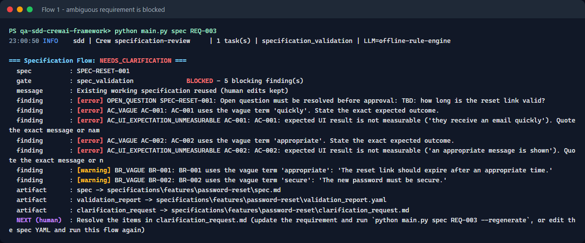

An approved specification passes both gates:

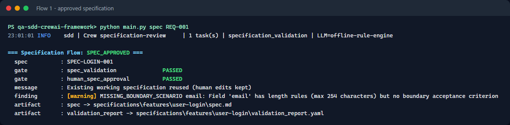

### What you do

1. Open `specifications/features/user-login/spec.md` (human-readable) and review it.
2. If something is wrong, edit the requirement and run `main.py spec REQ-001 --regenerate`, or edit
   `spec.yaml` / `acceptance_criteria.yaml` directly and run `main.py spec REQ-001` again.
3. When you agree, approve:

```powershell
& $py main.py approve SPEC-LOGIN-001 --stage spec --by "Your Name" --comment "Reviewed with PO"
```

The approval is written to `specifications/approved/SPEC-LOGIN-001/v1.0/approvals.yaml` together with a
read-only snapshot of the spec. Approvers named like an AI or a system are refused.

**Files produced:** `specifications/features/user-login/` → `spec.yaml`, `acceptance_criteria.yaml`, `spec.md`,
`validation_report.yaml` (+ `clarification_request.md` when blocked).

---

## Flow 2: Test design

**Goal:** derive scenarios, detailed test cases and test data from the **approved** specification.
**Command:** `main.py design SPEC-LOGIN-001` · **Code:** `flows/test_design_flow.py`

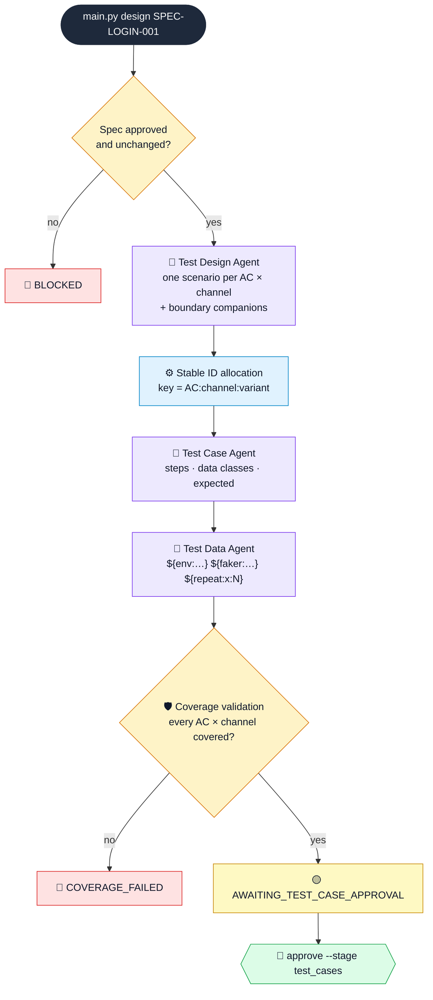

### Step by step

1. **Gate:** the flow reads only the approved snapshot. If the working spec changed after approval, it stops.
2. **Test Design Agent** creates one base scenario per AC and channel. `AC-001 [UI, API]` gives two scenarios.
   For length rules it adds an *on-the-limit* companion scenario.
3. **Stable IDs.** The framework assigns `TS-LOGIN-nnn` / `TC-LOGIN-nnn` by key, not by position. Regenerating
   later keeps the same IDs for the same AC/channel/variant.
4. **Test Case Agent** writes numbered steps, data classes per field and a measurable expected result.
5. **Test Data Agent** writes `test_data/user-login.yaml`. Values are *expressions*: credentials come from
   `${env:SDD_DEMO_USER_PASSWORD}`, never literal secrets.
6. **Coverage gate** (`validators/coverage_validator.py`) fails if any AC × channel has no test case.

A generated test case (`specifications/features/user-login/test_cases.md`):

```text
## TC-LOGIN-001: Submit a valid email and password -> they are navigated to the Dashboard page [UI]
- AC: AC-001 | Scenario: TS-LOGIN-001 | Channel: UI | Priority: P1 | Automation: UI-TEST-LOGIN-001
| # | Action   | Target              | Data  | Expected                                |
| 1 | navigate | Login page (/login) |       | Login page is displayed                 |
| 2 | fill     | Email               | valid |                                         |
| 3 | fill     | Password            | valid |                                         |
| 4 | click    | Sign in button      |       |                                         |
| 5 | verify   |                     |       | User is navigated to the Dashboard page |
```

### What you do

Review `test_cases.md`, then:

```powershell
& $py main.py approve SPEC-LOGIN-001 --stage test_cases --by "Your Name"
```

**Files produced:** `test_scenarios.yaml`, `test_cases.yaml`, `test_cases.md`, `coverage_report.yaml`,
`test_data/user-login.yaml`.

---

## Flow 3: Automation

**Goal:** turn approved test cases into Playwright (UI) and HTTPX (API) pytest code, validated and staged for
review before anything can run.
**Command:** `main.py automate SPEC-LOGIN-001` · **Code:** `flows/automation_flow.py`

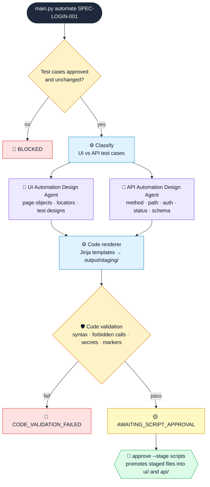

### Step by step

1. **Gate:** approved test cases only.
2. **Classify** active test cases by channel.
3. **UI Automation Design Agent** designs a Page Object per spec page (`LoginPage`, `DashboardPage`) with
   accessible locators (label / role), the field-to-locator mapping, the submit control and one test design per
   UI test case.
4. **API Automation Design Agent** designs each API test from the OpenAPI contract: method, path, auth,
   precondition (e.g. "an existing user"), payload data classes, expected status and body, schema check, and
   whether it is **destructive** (DELETE).
5. **Code renderer** writes Python from `templates/*.j2` into `output/staging/<SPEC>/`. Agents never write code
   directly. Each test sits in its own region:

   ```python
   # >>> sdd:begin UI-TEST-LOGIN-001
   @pytest.mark.spec('SPEC-LOGIN-001', '1.0')
   @pytest.mark.ac('AC-001')
   @pytest.mark.tc('TC-LOGIN-001')
   @pytest.mark.automation_id('UI-TEST-LOGIN-001')
   def test_tc_login_001_submit_a_valid_email_and_password(page, base_url): ...
   # <<< sdd:end UI-TEST-LOGIN-001
   ```

6. **Code validation** (`validators/code_validator.py`) rejects syntax errors, forbidden imports and calls
   (`subprocess`, `eval`, `os.system`, …), hard-coded secrets and tests without trace markers.

### What you do

Review the staged files in `output/staging/SPEC-LOGIN-001/`, then:

```powershell
& $py main.py approve SPEC-LOGIN-001 --stage scripts --by "Your Name"
```

Approval **promotes** the scripts into `ui/pages/`, `ui/tests/` and `api/tests/`, and records a hash of each
region. If anyone edits a promoted region later, execution refuses to run it.

---

## Flow 4: Execution

**Goal:** run approved scripts, store verified results, analyse failures and build the reports.
**Command:** `main.py execute` · **Code:** `flows/execution_flow.py`, `flows/stages.py`

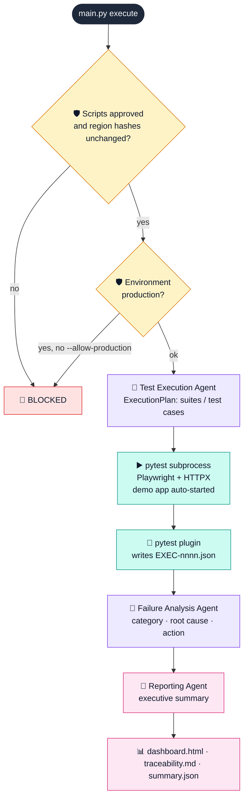

### Step by step

1. **Gates:** only approved, unmodified scripts; production environments are blocked by default.
2. **Plan:** the Test Execution Agent turns your request (`--suite`, `--tc`, spec IDs) into an `ExecutionPlan`.
   Pytest, not the agent, runs the tests.
3. **Run:** a pytest subprocess with Playwright and HTTPX. For `SDD_ENV=local` the demo app starts
   automatically. Screenshots and traces are kept for failures in `output/test-results/EXEC-nnnn/`.
4. **Record:** `core/pytest_plugin.py` writes `output/executions/EXEC-nnnn.json`. This is the **only** source of
   pass/fail. If pytest crashes, the run is stored with no results rather than invented ones.
5. **Analyse:** the Failure Analysis Agent classifies each failure (`APPLICATION_DEFECT`, `AUTOMATION_ISSUE`,
   `ENVIRONMENT_ISSUE`, `SPEC_IMPLEMENTATION_DRIFT`, `TEST_DATA_ISSUE`, `UNKNOWN`). This is advisory and labelled
   "probable". If the LLM is unavailable, the run still completes.
6. **Report:** the dashboard, traceability matrix and summary are rebuilt.

### Useful variants

```powershell
& $py main.py execute                              # everything approved
& $py main.py execute SPEC-LOGIN-001               # one specification
& $py main.py execute --suite smoke                # one suite
& $py main.py execute --tc TC-LOGIN-003 --tc TC-LOGIN-005
& $py main.py execute --headed --slowmo 500        # watch the browser
& $py main.py execute --env qa --allow-destructive # another environment
```

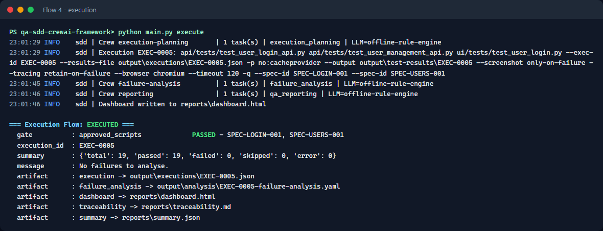

What the UI tests drive in the browser:

| Login page | Field validation | Invalid credentials | Dashboard |
|---|---|---|---|
| 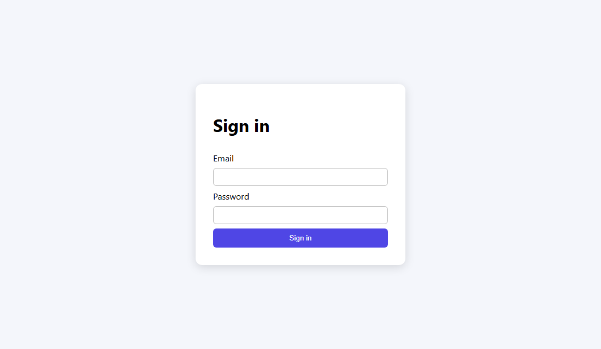 | 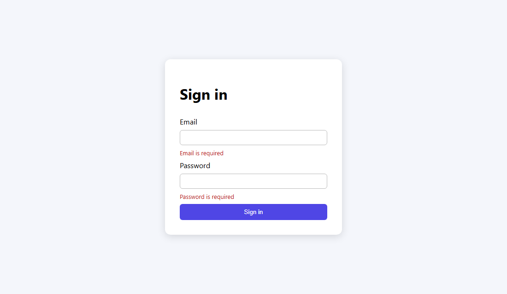 | 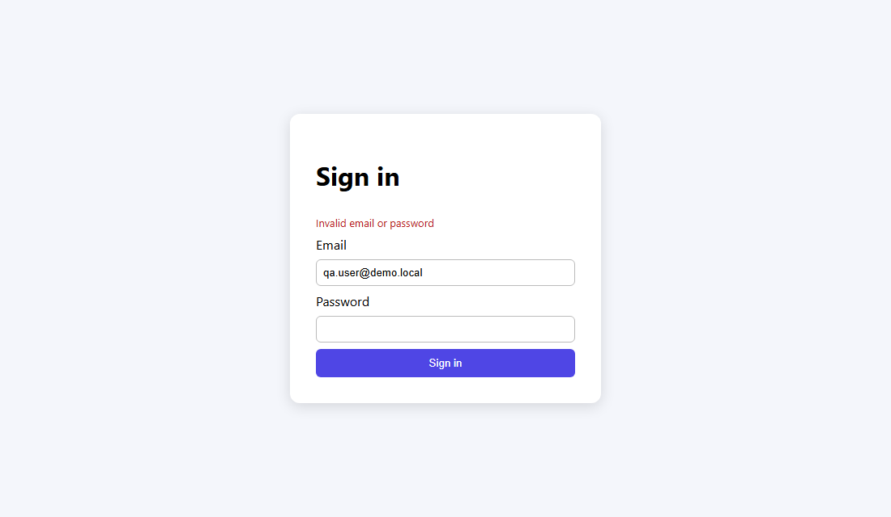 |  |

Then open `reports/dashboard.html`:

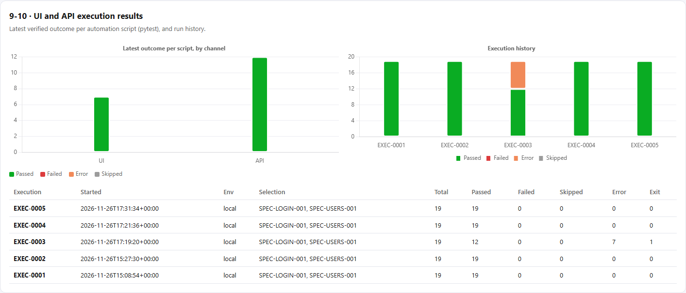
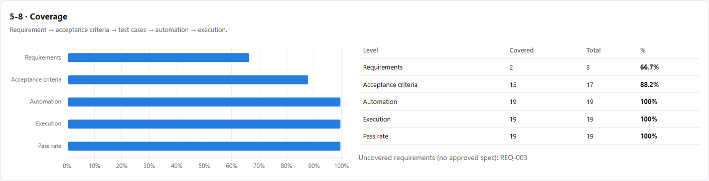

---

## Flow 5: Specification change impact

**Goal:** when a specification changes, regenerate and re-run **only what is impacted**, with the same three
human gates.
**Command:** `main.py change SPEC-LOGIN-001` (run it again after each approval) · **Code:** `flows/change_impact_flow.py`

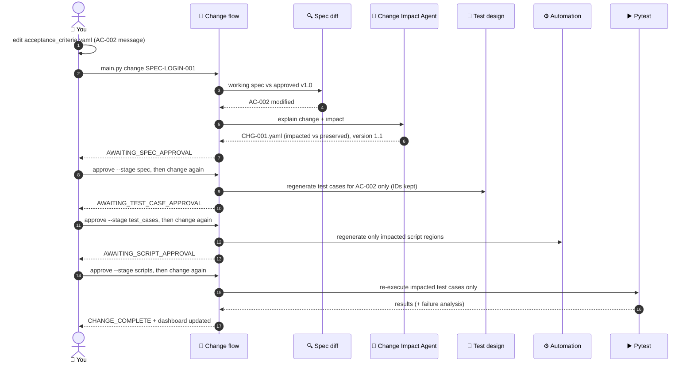

### Try it

```powershell
# 1. change the expected message of AC-002 in the working spec
notepad specifications\features\user-login\acceptance_criteria.yaml

# 2. detect the change -> v1.1, CHG-001.yaml, waits for spec approval
& $py main.py change SPEC-LOGIN-001
& $py main.py approve SPEC-LOGIN-001 --stage spec --by "Your Name"

# 3. regenerate impacted test cases -> waits for test case approval
& $py main.py change SPEC-LOGIN-001
& $py main.py approve SPEC-LOGIN-001 --stage test_cases --by "Your Name"

# 4. regenerate impacted script regions -> waits for script approval
& $py main.py change SPEC-LOGIN-001
& $py main.py approve SPEC-LOGIN-001 --stage scripts --by "Your Name"

# 5. re-execute impacted tests only
& $py main.py change SPEC-LOGIN-001
```

The demo app still returns the old message, so the impacted tests fail and the Failure Analysis Agent reports
`SPEC_IMPLEMENTATION_DRIFT`: the spec and the application disagree. Make the app match the new spec and re-run:

```powershell
$env:SDD_DEMO_LOGIN_ERROR = "<the new message>"
& $py main.py execute SPEC-LOGIN-001
```

### What is preserved

| Artifact | After a change to AC-002 |
|---|---|
| Spec v1.0 snapshot | untouched (read-only); v1.1 becomes the new approved version |
| Test cases for AC-001, AC-003 … | identical, same IDs |
| Test cases for AC-002 | regenerated, **same IDs** |
| Script regions not linked to AC-002 | byte-for-byte identical |
| Script regions for AC-002 | regenerated |
| Executed tests | only the AC-002 test cases |

Every step is recorded in `specifications/changes/CHG-001.yaml` (`history:`) and shown in the dashboard's
*Specification change impact* section. `main.py history SPEC-LOGIN-001` lists versions, approvals and changes.

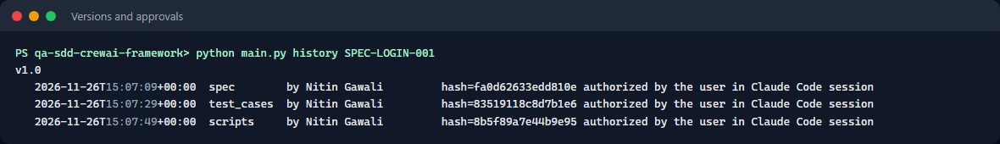

---

## 4. Shortcut: `main.py run`

`main.py run REQ-001 REQ-002` runs flows 1 → 4 for each requirement and stops at the first human gate that is
still open. Use it after each approval to move every feature forward in one command.

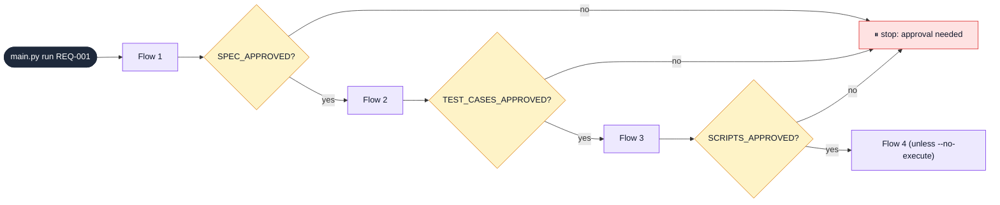

The guided demo `.\scripts\run_demo.ps1 -Approver "Your Name"` does the same and asks you at every gate.

---

## 5. Writing your own requirement

Create `specifications/requirements/REQ-004.md`. The format the parser understands:

```markdown
---
id: REQ-004
title: Profile Update
feature: profile-update
feature_code: PROFILE
priority: P2
---
# REQ-004: Profile Update

## User Story
As a signed-in user, I want to change my display name so that colleagues recognise me.

## Business Rules
- The display name is required and must be at most 50 characters.

## Input Fields
| Field | Type | Required | Rules | UI Label |
|---|---|---|---|---|
| display_name | string | yes | 1-50 characters | Display name |

## Acceptance Criteria
- AC-001 [UI, API]: Given a signed-in user, when they save a valid display name, then the message "Profile saved" is displayed.
  - API: returns 200 with "display_name"
- AC-002 [UI]: Given the Profile page, when the user saves an empty display name, then the validation message "Display name is required" is displayed.

## UI
| Page | Path | Elements |
|---|---|---|
| Profile | /profile | Display name (textbox), Save (button) |

## API
- PATCH /api/profile - Update the current user's profile
```

Rules of thumb that keep the validator happy:

- **One AC = one observable outcome.** Quote exact UI messages, or name the target page.
- **API ACs need a status code** (`- API: returns 401 …`, or "then the API returns 201").
- **Avoid vague words:** *quickly*, *appropriate*, *secure*, *user-friendly*, *etc.* Give numbers instead.
- **Every endpoint must exist in** `specifications/api/openapi.yaml`.
- **Name channels** in brackets: `[UI]`, `[API]`, `[UI, API]`.
- **Resolve every `TBD`** before asking for approval.

`PATCH /api/profile` in this example is not in the demo contract yet: add it to `openapi.yaml` first, or
Flow 1 blocks with `AC_API_NOT_IN_OPENAPI`. Then run `main.py spec REQ-004` and follow Flows 1 → 4. Note that the included demo app implements only login
and user management; to *execute* tests for a new feature, the application under test must implement it (point
an environment's `base_url` at your real QA system in `config/framework.yaml`).

---

## 6. Where every artifact lives

```mermaid
flowchart LR
  subgraph REQ["specifications/requirements/"]
    r1["REQ-001.md"]:::a
    r2["analysis/REQ-001.yaml"]:::a
  end
  subgraph FEAT["specifications/features/user-login/"]
    f1["spec.yaml · acceptance_criteria.yaml · spec.md"]:::b
    f2["validation_report.yaml"]:::b
    f3["test_scenarios.yaml · test_cases.yaml/.md"]:::b
    f4["coverage_report.yaml · automation_spec.yaml"]:::b
  end
  subgraph APPR["specifications/approved/SPEC-LOGIN-001/v1.0/"]
    p1["spec snapshot · approvals.yaml"]:::c
    p2["approved test cases · script hashes"]:::c
  end
  subgraph CODE["ui/ · api/ · test_data/"]
    c1["pages + tests (promoted)"]:::d
  end
  subgraph OUT["output/ · reports/"]
    o1["executions/EXEC-nnnn.json"]:::e
    o2["analysis/ · audit/audit.jsonl"]:::e
    o3["dashboard.html · traceability.md"]:::e
  end
  REQ --> FEAT --> APPR --> CODE --> OUT

  classDef a fill:#dbeafe,stroke:#2563eb,color:#0f172a
  classDef b fill:#ede9fe,stroke:#7c3aed,color:#0f172a
  classDef c fill:#dcfce7,stroke:#16a34a,color:#0f172a
  classDef d fill:#ccfbf1,stroke:#0d9488,color:#0f172a
  classDef e fill:#fce7f3,stroke:#db2777,color:#0f172a
```

| Path | Written by | Edit by hand? |
|---|---|---|
| `specifications/requirements/*.md` | you | ✅ yes, this is your input |
| `specifications/features/<f>/spec.yaml`, `acceptance_criteria.yaml` | Flow 1 | ✅ yes, then run `spec` or `change` |
| `specifications/features/<f>/spec.md`, `test_cases.md` | rendered | ❌ regenerated from YAML |
| `specifications/approved/**` | `approve` | ❌ never (read-only snapshots) |
| `specifications/changes/CHG-nnn.yaml` | Flow 5 | ❌ |
| `ui/pages/`, `ui/tests/`, `api/tests/` | Flow 3 + approval | ❌ change the spec and regenerate |
| `output/**`, `reports/**` | Flow 4 | ❌ |

---

## 7. Behind the scenes: how a flow uses CrewAI

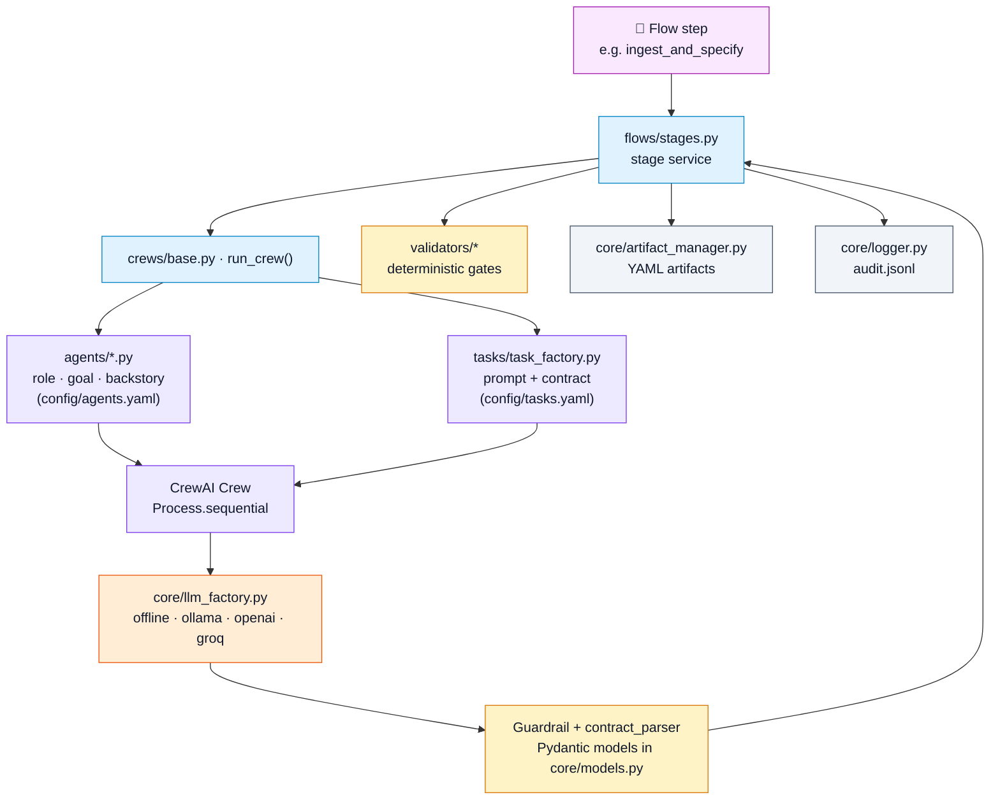

- **Flows** (`flows/*.py`) hold the order and the gates (`@router` returns the next branch).
- **Stages** (`flows/stages.py`) do the real work: call crews, run validators, save artifacts.
- **Crews** (`crews/*.py`) group agents and tasks; tasks pass context to each other (`context:` in `tasks.yaml`).
- Each task description contains a marker `[[sdd-task:<key>]]` and a JSON `<<<INPUT … INPUT>>>` block. The offline
  LLM uses them to route to the rule engine (`generators/`); a real LLM simply reads them as instructions.
- Every reply must parse into the task's Pydantic model, or the guardrail sends it back (max 3 retries).

---

## 8. FAQ

**Can an agent approve something?**
No. Approval is a separate CLI command that needs a human name, and names that look like an AI/agent/system
are refused. Agents have no tool that writes approvals.

**I edited a generated test by hand and now execution is blocked. Why?**
The region hash no longer matches the approved one. Generated code is never edited by hand: change the
specification (or the template) and regenerate it through Flow 3 or Flow 5, then approve the new scripts.

**Why did my spec fail with `AC_MISSING_FROM_SPEC`?**
The specification lost an AC that exists in the requirement file. This usually happens with a weaker LLM. The
validator compares against the raw requirement file, so a dropped AC can never pass silently.

**Does it need the internet?**
Not with `LLM_PROVIDER=offline`. Only the dashboard loads Chart.js and Mermaid from a CDN when opened.

**How do I see the browser?**
`main.py execute --headed --slowmo 500`.

**Where do I look when something goes wrong?**
`output/executions/EXEC-nnnn.log` (pytest output), `output/test-results/EXEC-nnnn/` (screenshots and traces),
`output/audit/audit.jsonl` (every event), `output/audit/rejected/` (LLM replies that failed the contract).
