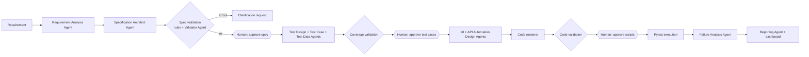

# SDD QA Automation Framework (CrewAI)

A **Spec-Driven Development** QA automation framework. Specifications are the single source of truth: every test
scenario, test case, automation script and execution result traces back to an approved, versioned specification.

**Stack:** Python 3.12 · CrewAI 1.x (Agents, Crews, Flows) · Playwright + Pytest (Page Object Model) ·
HTTPX + OpenAPI + jsonschema · Pydantic contracts · Ollama / OpenAI / offline rule engine.



## Core principles and how they are enforced

| Principle | Enforcement in code |
|---|---|
| Specification first | Test design only reads an **approved snapshot** (`VersionManager.load_approved`). Automation only reads approved test cases. |
| Single source of truth | `spec.yaml` + `acceptance_criteria.yaml`; `spec.md` is rendered from them. Every artifact stores `spec_id`, `spec_version`, `ac_hash`. |
| Traceability | `REQ → SPEC → AC → TS → TC → UI/API-TEST → EXEC`; pytest markers `spec/ac/tc/automation_id` on every test; `traceability/engine.py`. |
| Validation | `validators/spec_validator.py` (deterministic hard gate: GWT form, measurable outcomes, vague terms, conflicts, OpenAPI binding, missing scenarios, **ACs not present in the requirement**). An agent can add findings; it can never remove a rule finding. |
| Controlled generation | Three **human** gates (`spec`, `test_cases`, `scripts`). An approval binds to the exact content hash; editing afterwards invalidates it. Approvals by "AI/agent/system" are refused. |
| Change impact | `versioning/spec_diff.py` + `traceability/engine.impact_of` + stable IDs (`id_allocator.py`) + region-level code merge (`code_renderer.merge_regions`): only impacted test cases and script regions are regenerated and re-executed. |
| No fabricated results | Results are written only by the pytest plugin (`core/pytest_plugin.py`). If pytest crashes, the run is stored with **no** results. AI failure analysis is stored separately and labelled "probable". |

## Project layout

```text
qa-sdd-crewai-framework/
├── specifications/
│   ├── requirements/          REQ-001.md (login), REQ-002.md (user API), REQ-003.md (deliberately ambiguous)
│   │   └── analysis/          structured requirements (Requirement Analysis Agent)
│   ├── features/<feature>/    spec.yaml, acceptance_criteria.yaml, spec.md, validation_report.yaml,
│   │                          test_scenarios.yaml, test_cases.yaml/.md, coverage_report.yaml, automation_spec.yaml
│   ├── api/openapi.yaml       API contract of the demo application
│   ├── schemas/               JSON Schemas of every artifact contract (scripts/export_schemas.py)
│   ├── approved/<SPEC>/v1.0/  immutable approved snapshots + approvals.yaml (+ approved test cases/scripts)
│   ├── changes/               CHG-nnn.yaml change records
│   └── registry.yaml
├── agents/        12 CrewAI agents (one module each; roles in config/agents.yaml)
├── tasks/         task factory (definitions + output contracts in config/tasks.yaml)
├── crews/         specification, review, test design, automation, analysis/reporting crews
├── flows/         5 CrewAI Flows + stages.py (stage services used by the flows)
├── core/          config, models (contracts), state, llm_factory (incl. offline BaseLLM), logger/audit,
│                  artifact_manager, script_manifest, pytest_plugin
├── generators/    offline rule engine (one handler per agent task) + deterministic code renderer
├── parsers/       requirement parser (MD/YAML/JSON/PDF/DOCX), OpenAPI parser
├── validators/    spec, coverage and code validators
├── traceability/  traceability engine, stable ID allocation
├── versioning/    version manager (snapshots, approvals), spec diff, optional Git commits
├── ui/            base/ (BasePage), components/, pages/ (generated POM), tests/ (generated)
├── api/           clients/ (HTTPX), services/, schemas/ (Pydantic), validators/, tests/ (generated)
├── reporting/     dashboard builder;  templates/  Jinja templates (spec.md, POM, tests, dashboard)
├── demo_app/      local FastAPI application under test (login UI + user API) - not a production system
├── test_data/     generated test data (expressions; no credentials)
├── tests/         framework unit tests
├── config/        framework.yaml, agents.yaml, tasks.yaml
└── main.py        CLI
```

### Agents

| # | Agent | Module | Output |
|---|---|---|---|
| 1 | Requirement Analysis | `agents/requirement_agent.py` | `StructuredRequirement` |
| 2 | Specification Architect | `agents/specification_agent.py` | `FeatureSpec` |
| 3 | Specification Validation | `agents/specification_validator.py` | `SpecReview` (+ rule `ValidationReport`) |
| 4 | Test Design | `agents/test_design_agent.py` | `TestScenarioSet` |
| 5 | Test Case Generation | `agents/test_case_agent.py` | `TestCaseSet` |
| 6 | UI Automation Design | `agents/ui_design_agent.py` | `UIAutomationDesign` → Playwright POM |
| 7 | API Automation Design | `agents/api_design_agent.py` | `APIAutomationDesign` → HTTPX tests |
| 8 | Test Data | `agents/test_data_agent.py` | `TestDataSet` |
| 9 | Test Execution | `agents/execution_agent.py` | `ExecutionPlan` (pytest runs it) |
| 10 | Failure Analysis | `agents/failure_analysis_agent.py` | `FailureAnalysisReport` |
| 11 | Reporting & Traceability | `agents/reporting_agent.py` | `ReportNarrative` + dashboard |
| 12 | Change Impact | `agents/change_impact_agent.py` | change narrative |

Agents **design** (structured, contract-checked output); `generators/code_renderer.py` **writes** the code from
Jinja templates, so generated code is reproducible and reviewable. Each test sits in a marked region
(`# >>> sdd:begin UI-TEST-LOGIN-003`), which makes selective regeneration possible.

### LLM providers

| `LLM_PROVIDER` | Behaviour |
|---|---|
| `offline` (default) | `OfflineRuleEngineLLM`, a real CrewAI `BaseLLM` that routes each task (`[[sdd-task:...]]`) to the deterministic rule engine. No network, reproducible; outputs are labelled `offline-rule-engine`. |
| `ollama` | `LLM(model="ollama/<LLM_MODEL>", base_url=OLLAMA_BASE_URL)` |
| `openai` | `LLM(model=OPENAI_MODEL)`; needs `OPENAI_API_KEY` |
| `groq` | Groq's OpenAI-compatible API (`GROQ_BASE_URL`, `GROQ_MODEL`, default `openai/gpt-oss-120b`); needs `GROQ_API_KEY`. The free tier allows 8,000 tokens/minute, so very large prompts can be refused. |

With a real LLM, the agents get the JSON contract in the prompt. A CrewAI **guardrail** validates every reply against the Pydantic model and sends any error back to the agent to fix (up to 3 retries). Facts stated in the requirement (pages, endpoints, inputs) are copied into the spec deterministically. Rejected replies are kept in `output/audit/rejected/`.

The validators run the same way with every provider. An LLM's output must fit the Pydantic contract and pass the rule gates.

## Installation (Windows PowerShell)

```powershell
cd qa-sdd-crewai-framework
python -m venv .venv
.\.venv\Scripts\python.exe -m pip install -r requirements.txt
.\.venv\Scripts\python.exe -m playwright install chromium
Copy-Item .env.example .env          # demo values work out of the box
```

## Running the lifecycle

```powershell
$py = ".\.venv\Scripts\python.exe"
& $py main.py spec REQ-001                       # Flow 1 -> AWAITING_SPEC_APPROVAL
& $py main.py approve SPEC-LOGIN-001 --stage spec --by "Your Name"
& $py main.py design SPEC-LOGIN-001              # Flow 2 -> AWAITING_TEST_CASE_APPROVAL
& $py main.py approve SPEC-LOGIN-001 --stage test_cases --by "Your Name"
& $py main.py automate SPEC-LOGIN-001            # Flow 3 -> staged scripts, AWAITING_SCRIPT_APPROVAL
& $py main.py approve SPEC-LOGIN-001 --stage scripts --by "Your Name"   # promotes scripts into ui/ & api/
& $py main.py execute                            # Flow 4 -> pytest, failure analysis, reports/dashboard.html
```

Each flow stops at a human gate and prints the exact next command. Other commands:

| Command | Purpose |
|---|---|
| `main.py run REQ-001 REQ-002` | flows 1-4 per requirement until the next human gate |
| `main.py change SPEC-LOGIN-001` | Flow 5. It is re-entrant: run it again after each approval to advance. |
| `main.py execute --suite smoke` / `--tc TC-LOGIN-003` | run a suite, or only the selected test cases |
| `main.py execute --allow-destructive` | needed for DELETE tests outside `local` |
| `main.py execute --headed --slowmo 500` | show the browser during UI tests, pausing 500 ms between actions |
| `main.py status` / `trace` / `report` / `history SPEC-…` | status, traceability matrix, dashboard, versions and approvals |
| `.\scripts\run_demo.ps1 -Approver "Your Name"` | guided end-to-end demo; asks you at every gate |
| `python -m pytest tests -p no:cacheprovider` | framework unit tests |

Generated tests can also be run directly with pytest, for example `pytest --tc TC-LOGIN-001`. The demo app starts automatically for the `local` environment.

## Change impact scenario

1. Edit `specifications/features/user-login/acceptance_criteria.yaml`. For example, change the AC-002 message.
2. `main.py change SPEC-LOGIN-001`:
   - diffs the working spec against the approved v1.0;
   - bumps the version to v1.1 and writes `specifications/changes/CHG-001.yaml`, listing impacted and preserved test cases and scripts;
   - asks for spec approval.
3. Run it again after each approval:
   - only test cases for the changed AC are regenerated (IDs are kept);
   - only their script regions are regenerated, and every other region stays byte-for-byte the same;
   - only the impacted test cases are re-executed.
4. The demo app still shows the old message, so the Failure Analysis Agent classifies the failure as `SPEC_IMPLEMENTATION_DRIFT`.
5. Set `SDD_DEMO_LOGIN_ERROR` to the new text and run `execute` again. The tests pass.

## Safety controls

- **Human approvals:** human-only approvals bound to content hashes. Approved snapshots are read-only and never overwritten.
- **Restricted execution:** a script runs only if it is approved and its region hash is unchanged since approval.
- **Timeouts:** a timeout for the whole run and for each test.
- **Production:** an environment flagged `production` is blocked unless `--allow-production` is passed.
- **Destructive operations:** `@pytest.mark.destructive` tests are skipped unless the environment or the flag allows them.
- **Code validation:** checks syntax, forbidden imports and calls (`subprocess`, `eval`, `os.system`, …), hard-coded secrets, and trace markers.
- **Secrets:** they live only in `.env` and are masked in the audit log (`output/audit/audit.jsonl`) and in API logs.
