# SDD QA Automation Framework (CrewAI)

A **Spec-Driven Development (SDD)** QA automation framework. The **specification is the single source of truth**:
every test scenario, test case, automation script and execution result traces back to an approved, versioned
specification, and nothing moves forward without passing a validation gate and a human approval.


> **New here?** Read [FLOW.md](FLOW.md). It walks through every flow from scratch, step by step, with the
> commands to type and the files each step produces.

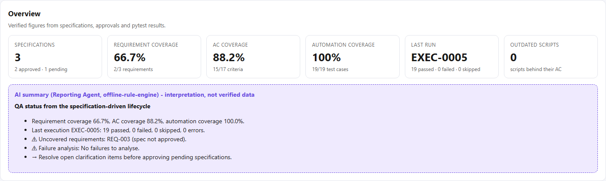

> **Want to see it run?** The [interactive live dashboard](#16-interactive-live-dashboard) lets you pick test
> cases and watch them move through every AI agent in real time.

---

## Table of contents

1. [What problem does this solve?](#1-what-problem-does-this-solve)
2. [The SDD lifecycle at a glance](#2-the-sdd-lifecycle-at-a-glance)
3. [Core principles and how the code enforces them](#3-core-principles-and-how-the-code-enforces-them)
4. [Architecture](#4-architecture)
5. [The 12 CrewAI agents](#5-the-12-crewai-agents)
6. [The 5 CrewAI flows](#6-the-5-crewai-flows)
7. [Traceability model](#7-traceability-model)
8. [Project layout](#8-project-layout)
9. [Installation](#9-installation)
10. [Quick start (5 minutes)](#10-quick-start-5-minutes)
11. [Command reference](#11-command-reference)
12. [LLM providers](#12-llm-providers)
13. [Configuration](#13-configuration)
14. [The demo application under test](#14-the-demo-application-under-test)
15. [Reports and the QA dashboard](#15-reports-and-the-qa-dashboard)
16. [Interactive live dashboard](#16-interactive-live-dashboard)
17. [Change impact and selective regeneration](#17-change-impact-and-selective-regeneration)
18. [Safety controls](#18-safety-controls)
19. [Testing the framework itself](#19-testing-the-framework-itself)
20. [Troubleshooting](#20-troubleshooting)

---

## 1. What problem does this solve?

AI can generate test cases and automation code quickly, but unchecked AI output drifts: it invents
requirements, drops acceptance criteria, and produces tests that no one can trace back to a business need.
This framework puts AI agents **inside** a strict Spec-Driven Development process:

| Without SDD | With this framework |
|---|---|
| Tests are written from memory or tickets | Tests are generated only from an **approved specification** |
| Nobody knows which requirement a test covers | Every test carries `spec`, `ac`, `tc` and `automation_id` markers |
| A requirement change means rewriting tests by hand | Only the **impacted** test cases and script regions are regenerated |
| AI output is trusted as-is | AI output must fit a **Pydantic contract** and pass **rule-based gates** |
| Anyone (or any agent) can "approve" | Three **human-only** approvals, each bound to a content hash |
| Pass/fail is reported by whoever ran it | Results are written **only by the pytest plugin**, never by an agent |

---

## 2. The SDD lifecycle at a glance

```mermaid
flowchart LR
  R["📄 Business requirement<br/>REQ-001.md"]:::input --> A["🤖 Requirement Analysis"]:::agent
  A --> S["🤖 Specification Architect"]:::agent
  S --> V{"🛡️ Spec validation<br/>rules + Validator agent"}:::gate
  V -- "errors" --> C["❓ Clarification request"]:::stop
  V -- "passed" --> H1{{"👤 Human approves spec"}}:::human
  H1 --> TD["🤖 Test Design + Test Cases + Test Data"]:::agent
  TD --> CV{"🛡️ Coverage validation"}:::gate
  CV --> H2{{"👤 Human approves test cases"}}:::human
  H2 --> AD["🤖 UI + API Automation Design"]:::agent
  AD --> G["⚙️ Code renderer<br/>Jinja templates"]:::engine
  G --> CK{"🛡️ Code validation"}:::gate
  CK --> H3{{"👤 Human approves scripts"}}:::human
  H3 --> X["▶️ Pytest + Playwright + HTTPX"]:::run
  X --> FA["🤖 Failure Analysis"]:::agent
  FA --> RP["📊 Reporting agent + dashboard"]:::report

  classDef input fill:#dbeafe,stroke:#2563eb,color:#0f172a
  classDef agent fill:#ede9fe,stroke:#7c3aed,color:#0f172a
  classDef gate fill:#fef3c7,stroke:#d97706,color:#0f172a
  classDef human fill:#dcfce7,stroke:#16a34a,color:#0f172a
  classDef stop fill:#fee2e2,stroke:#dc2626,color:#0f172a
  classDef engine fill:#e0f2fe,stroke:#0284c7,color:#0f172a
  classDef run fill:#ccfbf1,stroke:#0d9488,color:#0f172a
  classDef report fill:#fce7f3,stroke:#db2777,color:#0f172a
```

**Legend:** blue = input · purple = AI agent · amber = automatic rule gate · green hexagon = human approval
gate · red = blocked · light blue = deterministic engine · teal = execution · pink = reporting

Each flow **stops at a human gate** and prints the exact command to run next. A gate is passed only when a
named person approves the exact content; editing the content afterwards invalidates the approval.

---

## 3. Core principles and how the code enforces them

| Principle | Enforcement in code |
|---|---|
| **Specification first** | Test design reads only an **approved snapshot** (`VersionManager.load_approved`). Automation reads only approved test cases. |
| **Single source of truth** | `spec.yaml` + `acceptance_criteria.yaml`. `spec.md` is *rendered* from them. Every artifact stores `spec_id`, `spec_version` and `ac_hash`. |
| **Traceability** | `REQ → SPEC → AC → TS → TC → UI/API-TEST → EXEC`. Pytest markers `spec / ac / tc / automation_id` on every test. Engine: `traceability/engine.py`. |
| **Validation** | `validators/spec_validator.py` is a deterministic hard gate: Given/When/Then form, measurable outcomes, vague terms, conflicts, OpenAPI binding, missing scenarios, ACs invented or dropped. An agent can **add** findings but can never **remove** a rule finding. |
| **Controlled generation** | Three human gates (`spec`, `test_cases`, `scripts`). An approval binds to the content hash. Approvers named "AI", "agent" or "system" are refused. |
| **Change impact** | `versioning/spec_diff.py` + `traceability/engine.impact_of` + stable IDs (`id_allocator.py`) + region-level code merge: only impacted test cases and script regions are regenerated and re-executed. |
| **No fabricated results** | Results are written only by `core/pytest_plugin.py`. If pytest crashes, the run is stored with **no** results. AI failure analysis is stored separately and labelled "probable". |

---

## 4. Architecture

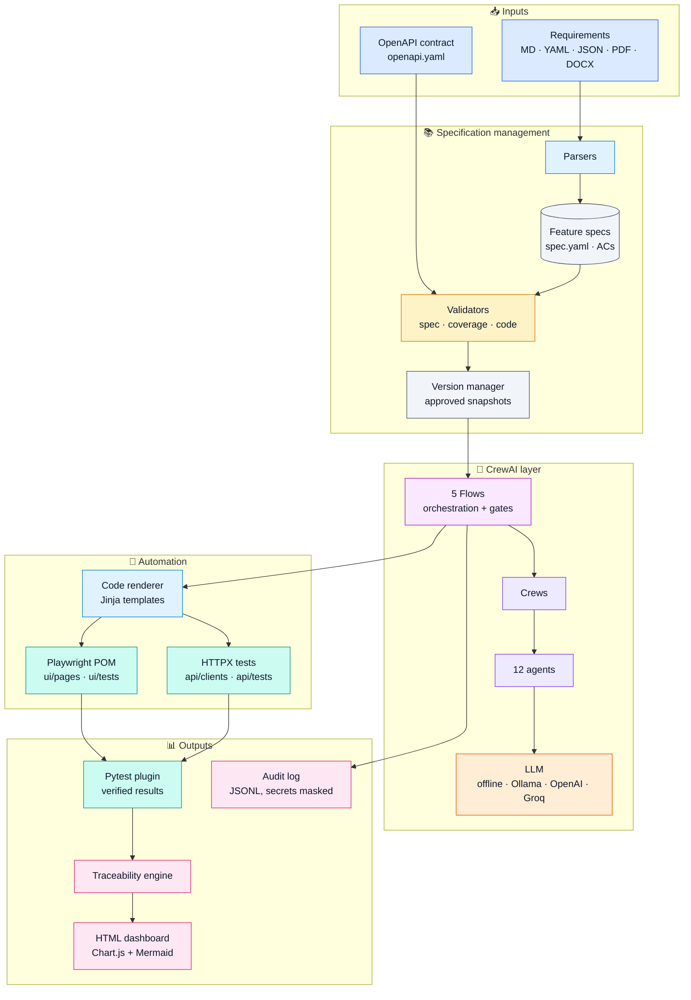

**Design rule: agents design, the renderer writes.** Agents return structured, contract-checked designs
(page objects, locators, test designs). `generators/code_renderer.py` turns those designs into Python from
Jinja templates. Generated code is therefore reproducible, reviewable and diff-friendly. Each test lives in a
marked region (`# >>> sdd:begin UI-TEST-LOGIN-003` … `# <<< sdd:end UI-TEST-LOGIN-003`), which is what makes
selective regeneration possible.

### How one task flows through CrewAI

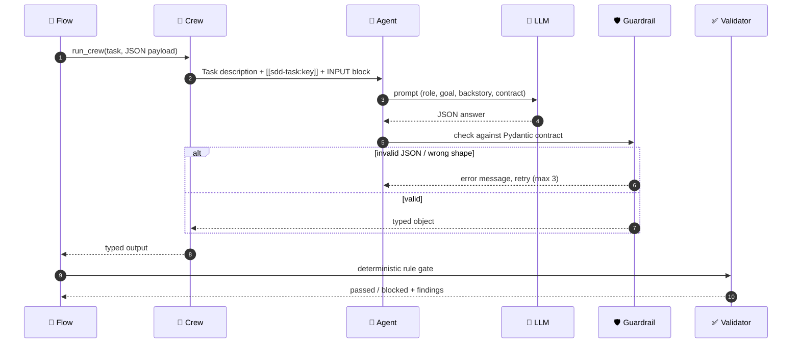

---

## 5. The 12 CrewAI agents

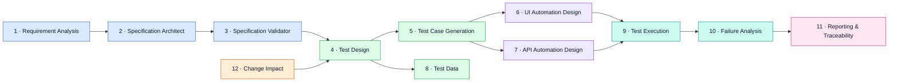

| # | Agent | Module | Output contract | What it does |
|---|---|---|---|---|
| 1 | Requirement Analysis | `agents/requirement_agent.py` | `StructuredRequirement` | Extracts rules, inputs, ACs, pages, endpoints; flags vague terms |
| 2 | Specification Architect | `agents/specification_agent.py` | `FeatureSpec` | Turns each AC into Given/When/Then with measurable UI/API expectations |
| 3 | Specification Validator | `agents/specification_validator.py` | `SpecReview` | Reviews the spec; adds findings on top of the rule report |
| 4 | Test Design | `agents/test_design_agent.py` | `TestScenarioSet` | One scenario per AC × channel, plus boundary companions |
| 5 | Test Case Generation | `agents/test_case_agent.py` | `TestCaseSet` | Steps, data classes, expected result, priority, tags |
| 6 | UI Automation Design | `agents/ui_design_agent.py` | `UIAutomationDesign` | Page objects, role/label locators, UI test designs |
| 7 | API Automation Design | `agents/api_design_agent.py` | `APIAutomationDesign` | Method, path, auth, payload, status, schema checks |
| 8 | Test Data | `agents/test_data_agent.py` | `TestDataSet` | Data expressions per class (`${env:…}`, `${faker:…}`, `${repeat:x:N}`) |
| 9 | Test Execution | `agents/execution_agent.py` | `ExecutionPlan` | Decides suites / test cases to run (pytest runs them) |
| 10 | Failure Analysis | `agents/failure_analysis_agent.py` | `FailureAnalysisReport` | Classifies failures and suggests root cause and action |
| 11 | Reporting & Traceability | `agents/reporting_agent.py` | `ReportNarrative` | Executive summary for the dashboard |
| 12 | Change Impact | `agents/change_impact_agent.py` | `ReportNarrative` | Explains a spec change, its impact and risks |

Roles, goals and backstories live in [`config/agents.yaml`](config/agents.yaml); task prompts and output
contracts live in [`config/tasks.yaml`](config/tasks.yaml). Every agent shares one rule: *never invent
acceptance criteria, never modify an approved specification, never fabricate execution results.*

Failure categories used by agent 10: `APPLICATION_DEFECT`, `AUTOMATION_ISSUE`, `ENVIRONMENT_ISSUE`,
`SPEC_IMPLEMENTATION_DRIFT`, `TEST_DATA_ISSUE`, `UNKNOWN`.

---

## 6. The 5 CrewAI flows

Each flow is a `crewai.flow.flow.Flow` with `@start`, `@listen` and `@router` steps. Routers implement the gates.
Full step-by-step walkthroughs are in [FLOW.md](FLOW.md).

| Flow | Command | Starts from | Stops at | Final status |
|---|---|---|---|---|
| 1 · Specification | `main.py spec REQ-001` | Requirement file | Spec approval | `SPEC_APPROVED` / `NEEDS_CLARIFICATION` |
| 2 · Test Design | `main.py design SPEC-LOGIN-001` | Approved spec | Test case approval | `TEST_CASES_APPROVED` / `COVERAGE_FAILED` |
| 3 · Automation | `main.py automate SPEC-LOGIN-001` | Approved test cases | Script approval | `SCRIPTS_APPROVED` / `CODE_VALIDATION_FAILED` |
| 4 · Execution | `main.py execute` | Approved, unmodified scripts | — | `EXECUTED` / `BLOCKED` |
| 5 · Change Impact | `main.py change SPEC-LOGIN-001` | Edited working spec | Each gate in turn (re-entrant) | `CHANGE_COMPLETE` |

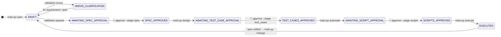

---

## 7. Traceability model

```mermaid
flowchart LR
  REQ["REQ-001<br/>requirement"]:::a --> SPEC["SPEC-LOGIN-001 v1.0<br/>specification"]:::b
  SPEC --> AC["AC-002<br/>acceptance criterion"]:::c
  AC --> TS["TS-LOGIN-003<br/>scenario"]:::d
  TS --> TC["TC-LOGIN-003<br/>test case"]:::e
  TC --> AUTO["UI-TEST-LOGIN-003<br/>script region"]:::f
  AUTO --> EXEC["EXEC-0005<br/>passed ✅"]:::g

  classDef a fill:#dbeafe,stroke:#2563eb,color:#0f172a
  classDef b fill:#e0e7ff,stroke:#4f46e5,color:#0f172a
  classDef c fill:#ede9fe,stroke:#7c3aed,color:#0f172a
  classDef d fill:#fae8ff,stroke:#a21caf,color:#0f172a
  classDef e fill:#fce7f3,stroke:#db2777,color:#0f172a
  classDef f fill:#ffedd5,stroke:#ea580c,color:#0f172a
  classDef g fill:#dcfce7,stroke:#16a34a,color:#0f172a
```

The link is real code, not documentation. Every generated test carries its trace:

```python
# >>> sdd:begin UI-TEST-LOGIN-001
@pytest.mark.spec('SPEC-LOGIN-001', '1.0')
@pytest.mark.ac('AC-001')
@pytest.mark.tc('TC-LOGIN-001')
@pytest.mark.automation_id('UI-TEST-LOGIN-001')
@pytest.mark.priority('P1')
def test_tc_login_001_submit_a_valid_email_and_password(page: Page, base_url: str) -> None:
    ...
# <<< sdd:end UI-TEST-LOGIN-001
```

IDs are **stable**: they are allocated by key `AC:channel:variant` (`traceability/id_allocator.py`), so
regenerating a test case after a change keeps its ID, its history and its dashboard row.

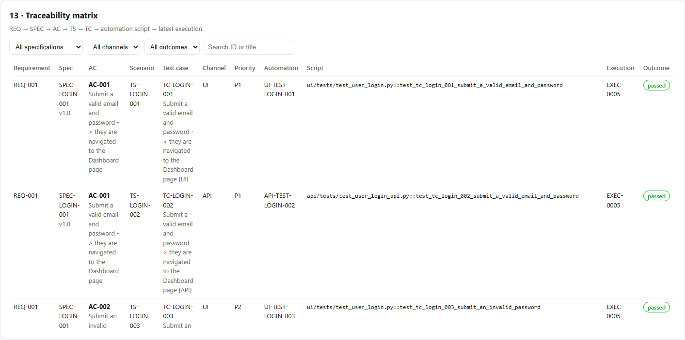

---

## 8. Project layout

```text
qa-sdd-crewai-framework/
├── specifications/
│   ├── requirements/          REQ-001.md (login), REQ-002.md (user API), REQ-003.md (deliberately ambiguous)
│   │   └── analysis/          structured requirements (Requirement Analysis Agent)
│   ├── features/<feature>/    spec.yaml, acceptance_criteria.yaml, spec.md, validation_report.yaml,
│   │                          test_scenarios.yaml, test_cases.yaml/.md, coverage_report.yaml, automation_spec.yaml
│   ├── api/openapi.yaml       API contract of the demo application
│   ├── schemas/               JSON Schemas of every artifact contract (scripts/export_schemas.py)
│   ├── approved/<SPEC>/v1.0/  immutable approved snapshots + approvals.yaml (+ approved test cases/scripts)
│   ├── changes/               CHG-nnn.yaml change records
│   └── registry.yaml
├── agents/        12 CrewAI agents (one module each; roles in config/agents.yaml)
├── tasks/         task factory (definitions + output contracts in config/tasks.yaml)
├── crews/         specification, review, test design, automation, analysis/reporting crews
├── flows/         5 CrewAI Flows + stages.py (stage services used by the flows)
├── core/          config, models (contracts), state, llm_factory (incl. offline BaseLLM), contract_parser,
│                  logger/audit, artifact_manager, script_manifest, pytest_plugin
├── generators/    offline rule engine (one handler per agent task) + deterministic code renderer
├── parsers/       requirement parser (MD/YAML/JSON/PDF/DOCX), OpenAPI parser
├── validators/    spec, coverage and code validators
├── traceability/  traceability engine, stable ID allocation
├── versioning/    version manager (snapshots, approvals), spec diff, optional Git commits
├── ui/            base/ (BasePage), components/, pages/ (generated POM), tests/ (generated)
├── api/           clients/ (HTTPX), services/, schemas/ (Pydantic), validators/, tests/ (generated)
├── reporting/     dashboard builder;  templates/  Jinja templates (spec.md, POM, tests, dashboard)
├── demo_app/      local FastAPI application under test (login UI + user API) - not a production system
├── test_data/     generated test data (expressions; no credentials)
├── tests/         framework unit tests
├── docs/images/   screenshots used in this README
├── Dashboard-qa-sdd-crewai-framework/   interactive live dashboard (FastAPI + single-page UI)
├── config/        framework.yaml, agents.yaml, tasks.yaml
├── FLOW.md        step-by-step guide to every flow
└── main.py        CLI
```

**What is generated vs. hand-written?**

| Hand-written (framework) | Generated by the lifecycle | Runtime output (git-ignored) |
|---|---|---|
| `core/`, `flows/`, `crews/`, `agents/`, `validators/`, `templates/` | `specifications/features/**`, `specifications/approved/**` | `output/executions/` (results, logs) |
| `ui/base/`, `ui/components/`, `api/clients/` | `ui/pages/*.py`, `ui/tests/*.py`, `api/tests/*.py` | `output/test-results/` (screenshots, traces) |
| `specifications/requirements/*.md` (you write these) | `test_data/*.yaml`, `reports/traceability.md` | `output/audit/`, `reports/dashboard.html` |

---

## 9. Installation

**Prerequisites:** Windows, macOS or Linux · Python **3.12** · Git · ~1 GB disk for the Playwright browser.
Optional: [Ollama](https://ollama.com) for a local LLM, or an OpenAI / Groq API key.

```powershell
git clone https://github.com/nitingawali148/sdd-based-ai-qa-automation-framework.git
cd sdd-based-ai-qa-automation-framework
python -m venv .venv
.\.venv\Scripts\python.exe -m pip install -r requirements.txt
.\.venv\Scripts\python.exe -m playwright install chromium
Copy-Item .env.example .env          # demo values work out of the box (offline LLM)
```

On macOS / Linux use `.venv/bin/python` and `cp .env.example .env`.

Check the installation:

```powershell
.\.venv\Scripts\python.exe main.py status
```

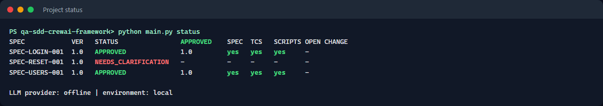

---

## 10. Quick start (5 minutes)

The repository already contains two approved features (login UI + API, user management API) and one
deliberately ambiguous requirement. Run the approved tests straight away:

```powershell
$py = ".\.venv\Scripts\python.exe"
& $py main.py execute                        # run all approved tests (headless)
& $py main.py execute --headed --slowmo 500  # same, with a visible browser
& $py main.py report                         # rebuild reports/dashboard.html
Start-Process reports\dashboard.html
```

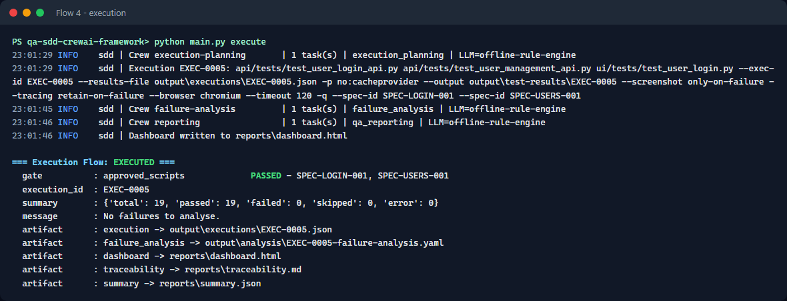

Then try the lifecycle on the ambiguous requirement to see a gate in action:

```powershell
& $py main.py spec REQ-003
```

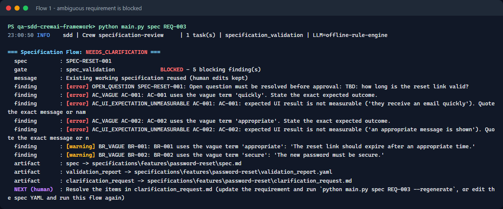

The validator refuses vague words such as *quickly*, *appropriate* and *secure*, and an unresolved `TBD`.
It writes `clarification_request.md` listing exactly what a human must clarify.

### Full lifecycle for a feature

```powershell
& $py main.py spec REQ-001                                               # Flow 1 -> AWAITING_SPEC_APPROVAL
& $py main.py approve SPEC-LOGIN-001 --stage spec --by "Your Name"
& $py main.py design SPEC-LOGIN-001                                      # Flow 2 -> AWAITING_TEST_CASE_APPROVAL
& $py main.py approve SPEC-LOGIN-001 --stage test_cases --by "Your Name"
& $py main.py automate SPEC-LOGIN-001                                    # Flow 3 -> AWAITING_SCRIPT_APPROVAL
& $py main.py approve SPEC-LOGIN-001 --stage scripts --by "Your Name"    # promotes scripts into ui/ & api/
& $py main.py execute                                                    # Flow 4 -> pytest + dashboard
```

Or run the guided demo, which pauses and asks you at every gate:

```powershell
.\scripts\run_demo.ps1 -Approver "Your Name"
```

---

## 11. Command reference

| Command | Purpose |
|---|---|
| `main.py spec REQ-001 [--regenerate]` | **Flow 1**: requirement → validated spec. `--regenerate` re-runs the agents (new version if one is approved). |
| `main.py approve SPEC-… --stage spec\|test_cases\|scripts --by "Name" [--comment …]` | Record a **human** approval bound to the current content hash |
| `main.py design SPEC-…` | **Flow 2**: approved spec → scenarios, test cases, test data |
| `main.py automate SPEC-…` | **Flow 3**: approved test cases → staged, validated scripts |
| `main.py execute [SPEC …]` | **Flow 4**: run approved scripts, analyse failures, build reports |
| `main.py execute --suite smoke` | run one suite (`smoke`, `sanity`, `functional`, `regression`) |
| `main.py execute --tc TC-LOGIN-003` | run only the selected test cases (repeatable) |
| `main.py execute --headed --slowmo 500` | show the browser, pausing 500 ms between actions |
| `main.py execute --env qa` | run against another environment from `config/framework.yaml` |
| `main.py execute --allow-destructive` | allow `DELETE` tests outside `local` |
| `main.py execute --allow-production` | allow an environment flagged `production` (blocked by default) |
| `main.py change SPEC-…` | **Flow 5**: detect a spec change and advance it; re-run after each approval |
| `main.py run REQ-001 REQ-002 [--no-execute]` | flows 1–4 per requirement until the next human gate |
| `main.py status` | specs, versions, approvals and open changes |
| `main.py trace` | print the traceability matrix and coverage |
| `main.py report` | rebuild `reports/dashboard.html`, `traceability.md`, `summary.json` |
| `main.py history SPEC-…` | approved versions, approvals and change records |
| `python -m pytest tests -p no:cacheprovider` | framework unit tests |
| `pytest --tc TC-LOGIN-001` | run generated tests directly with pytest (demo app starts automatically) |

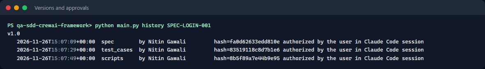

---

## 12. LLM providers

Set `LLM_PROVIDER` in `.env`.

| `LLM_PROVIDER` | Behaviour |
|---|---|
| `offline` (default) | `OfflineRuleEngineLLM`, a real CrewAI `BaseLLM` that routes each task (`[[sdd-task:…]]`) to the deterministic rule engine. No network, reproducible; outputs are labelled `offline-rule-engine`. |
| `ollama` | `LLM(model="ollama/<LLM_MODEL>", base_url=OLLAMA_BASE_URL)`. Recommended for private data. |
| `openai` | `LLM(model=OPENAI_MODEL)`; needs `OPENAI_API_KEY`. |
| `groq` | Groq's OpenAI-compatible API (`GROQ_BASE_URL`, `GROQ_MODEL`, default `openai/gpt-oss-120b`); needs `GROQ_API_KEY`. The free tier allows 8,000 tokens/minute, so very large prompts can be refused. |

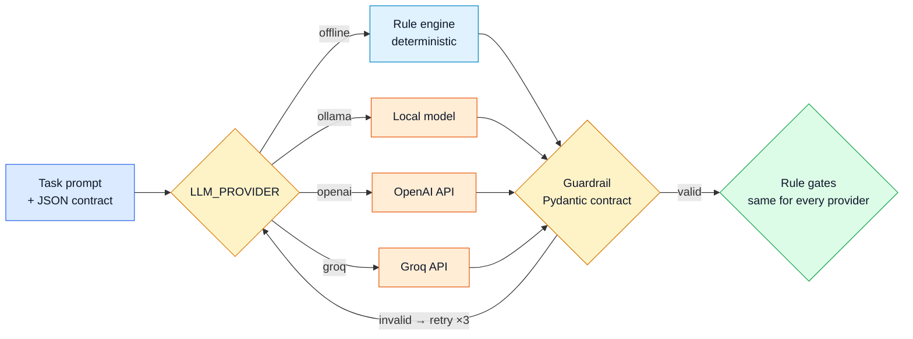

With a real LLM, the agents get the JSON contract in the prompt. A CrewAI **guardrail** validates every reply
against the Pydantic model and sends any error back to the agent to fix (up to 3 retries). Facts stated in the
requirement (pages, endpoints, inputs) are copied into the spec deterministically. Rejected replies are kept in
`output/audit/rejected/`. If AI failure analysis is unavailable (for example a rate limit), the execution is
still recorded and the dashboard still built; only the advisory analysis is skipped.

---

## 13. Configuration

| File | What it controls |
|---|---|
| `.env` | LLM provider, model and keys; target environment (`SDD_ENV`); demo app credentials and port. **Never committed.** |
| `config/framework.yaml` | paths, required approval stages, validation strictness, versioning, execution timeouts, environments |
| `config/agents.yaml` | role, goal and backstory of each agent |
| `config/tasks.yaml` | task prompts, output contracts and task context chaining |
| `pytest.ini` | test paths, markers, plugin registration |

Key settings in `config/framework.yaml`:

```yaml
approval:
  required_stages: [spec, test_cases, scripts]   # can never be approved by an agent
validation:
  block_on_warnings: false                       # errors always block
  ac_trace_similarity: 0.55                      # spec AC must still match its requirement text
execution:
  timeout_seconds: 900                           # whole pytest run
  per_test_timeout_seconds: 120
  browser: chromium
  headed: false                                  # or pass --headed on the CLI
environments:
  local: {base_url: "http://127.0.0.1:${SDD_DEMO_PORT}", start_demo_app: true,  production: false}
  qa:    {base_url: "https://qa.example.invalid",        start_demo_app: false, production: false}
  prod:  {base_url: "https://app.example.invalid",       start_demo_app: false, production: true}
```

---

## 14. The demo application under test

`demo_app/` is a small local FastAPI app so the whole lifecycle runs end to end without external systems.
Pytest starts it automatically for the `local` environment (default port `8765`).

| UI page | Path | | API | Endpoint |
|---|---|---|---|---|
| Login | `/login` | | Auth | `POST /api/auth/login` |
| Dashboard | `/dashboard` | | Users | `GET/POST /api/users`, `GET/PUT/PATCH/DELETE /api/users/{id}` |

| Login page | Field validation (AC-003/004) |
|---|---|
| 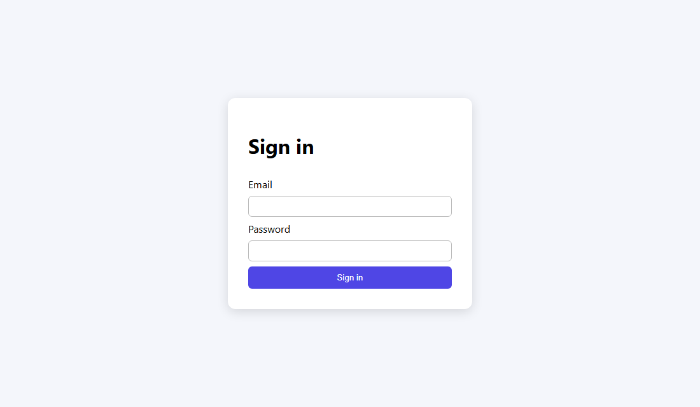 | 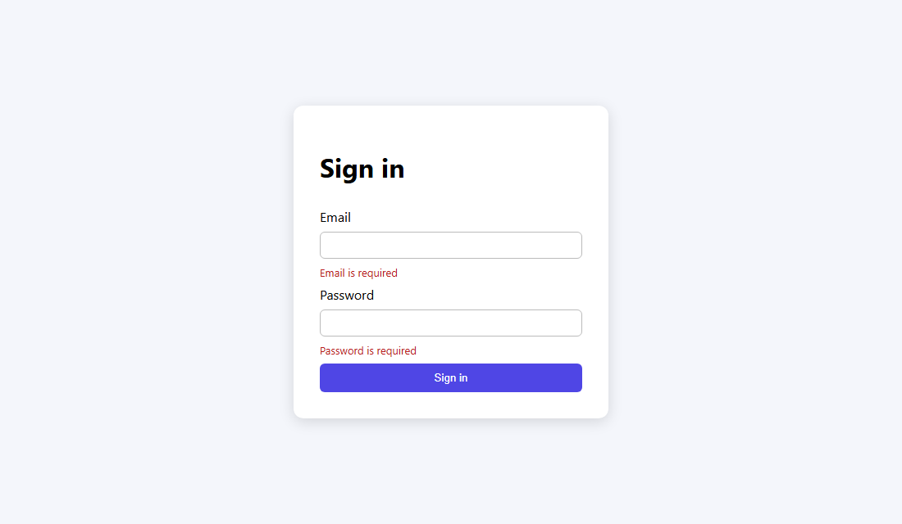 |
| **Invalid credentials (AC-002/005)** | **Successful login (AC-001)** |
| 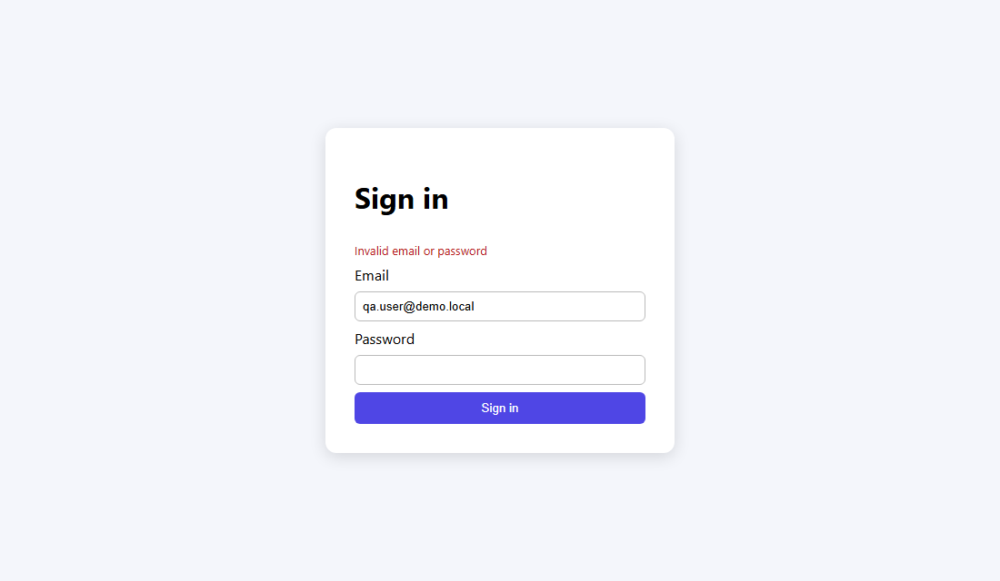 |  |

Demo credentials come from `.env` (`SDD_DEMO_USER_EMAIL`, `SDD_DEMO_USER_PASSWORD`, …).
`SDD_DEMO_LOGIN_ERROR` changes the invalid-credentials message, which is used to demonstrate
*spec–implementation drift* (section 17).

---

## 15. Reports and the QA dashboard

`main.py execute` and `main.py report` write:

| File | Content |
|---|---|
| `reports/dashboard.html` | interactive dashboard (open in a browser; needs internet for Chart.js / Mermaid CDNs) |
| `reports/traceability.md` | traceability matrix in Markdown |
| `reports/summary.json` | machine-readable coverage and execution summary |
| `output/executions/EXEC-nnnn.json` + `.log` | verified pytest results and raw log per run |
| `output/test-results/EXEC-nnnn/` | screenshots and Playwright traces of failed tests |
| `output/analysis/EXEC-nnnn-failure-analysis.yaml` | AI failure analysis (advisory) |
| `output/audit/audit.jsonl` | every agent, crew, flow, approval and execution event |

Dashboard sections (real screenshots from this repository):

**Overview** - verified KPIs plus a clearly labelled AI summary


**SDD workflow** - rendered with Mermaid
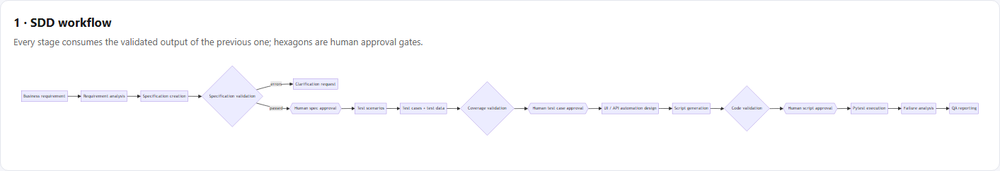

**Specification status, versions, approvals and findings**
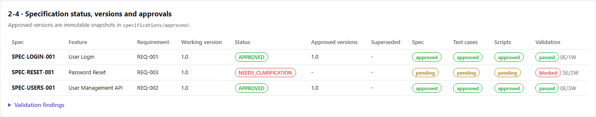

**Coverage** - requirement → AC → automation → execution → pass rate
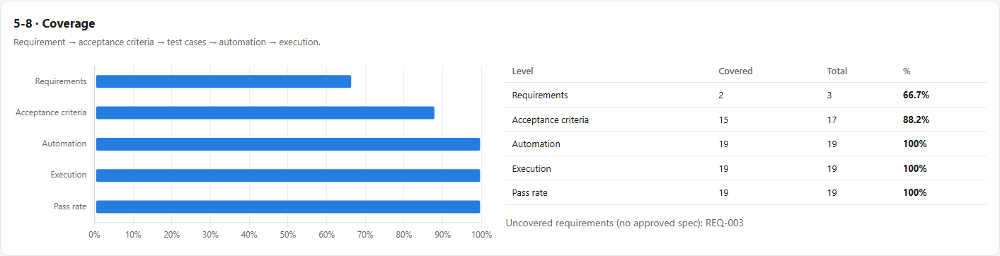

**UI and API execution results** with run history
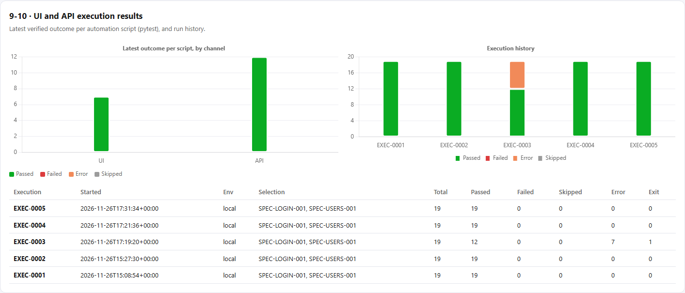

**Failure analysis** and **specification change impact**
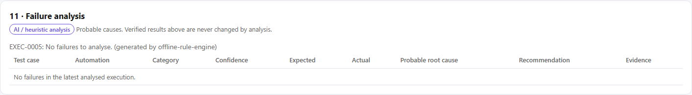
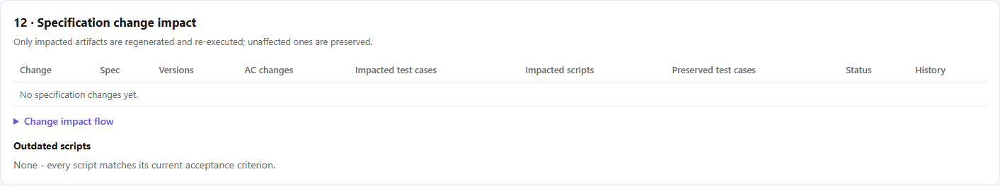

**Agent execution history**
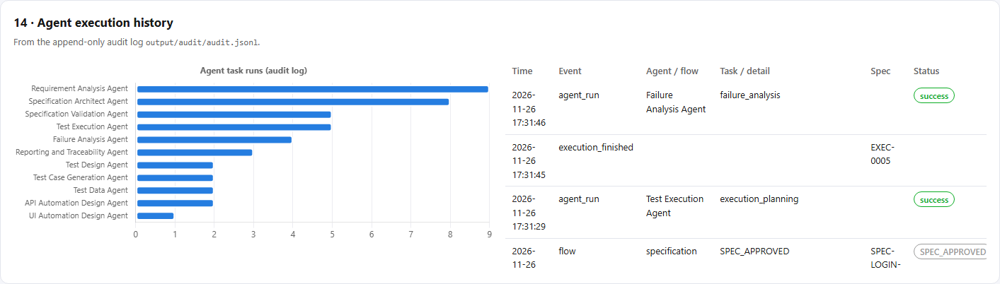

**Architecture and agent collaboration**
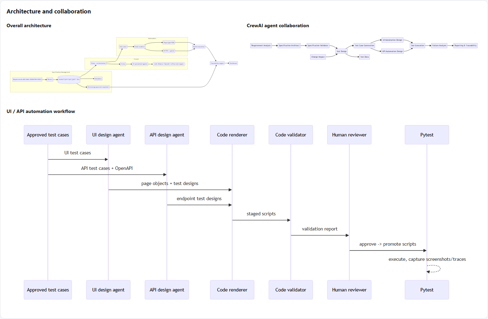

---

## 16. Interactive live dashboard

[`Dashboard-qa-sdd-crewai-framework/`](Dashboard-qa-sdd-crewai-framework/) is a web app for demonstrations
and day-to-day monitoring. Pick test cases from a dropdown, press **Run**, and watch each one move through the
AI agents live: status, current activity, progress, each agent's output, the execution log and a final report.

```powershell
cd Dashboard-qa-sdd-crewai-framework
.\run.ps1          # reuses the framework's .venv and opens http://127.0.0.1:8090
```

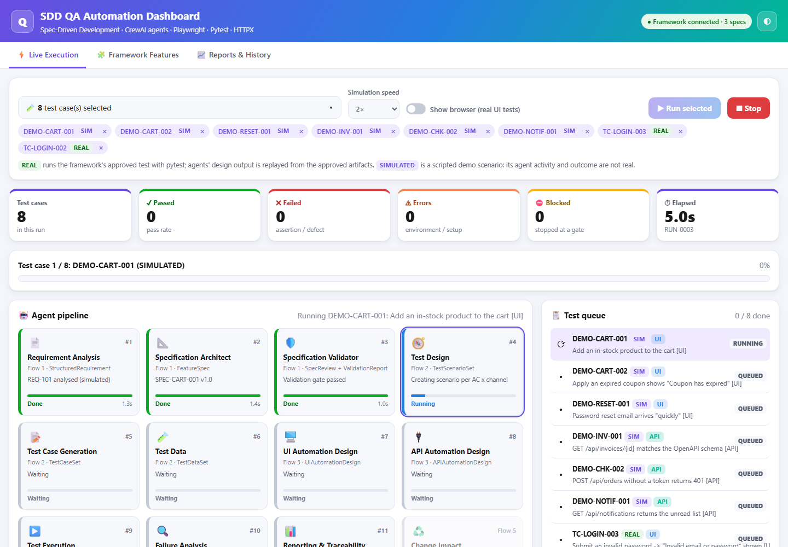

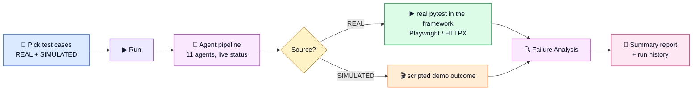

**Two kinds of test case, always labelled:**

| Label | What happens |
|---|---|
| **REAL** | One of the framework's approved test cases. The agents' design output is replayed from the approved artifacts (including the real generated code), and the execution step **really runs pytest**. The result comes only from the pytest plugin; failures are classified with the framework's own rules. |
| **SIMULATED** | A dummy demo scenario (cart, checkout, search, billing, …) with scripted agent activity and outcome. They cover every path: pass, application defect, automation issue, spec drift, test data issue, environment error, and a spec blocked at the validation gate. |

**What it shows:**

- **Live Execution:** a searchable multi-select picker with presets, simulation speed and a *Show browser*
  (headed) switch; KPI tiles; an agent card per agent with live status, activity, progress and duration;
  each agent's output; the test queue; a filterable colour-coded log; outcome and time-per-agent charts; a
  failure analysis table; and a summary report you can download as JSON.
- **Framework Features:** SDD principles, the lifecycle diagram, the 12 agents (read from `config/agents.yaml`),
  the 5 flows with copyable commands, the safety controls, the LLM providers, and a real snapshot of the
  specifications and approvals.
- **Reports & History:** past dashboard runs, and this framework's own `EXEC-*` executions.

A completed run of the *Showcase mix* (6 simulated + 2 real test cases):

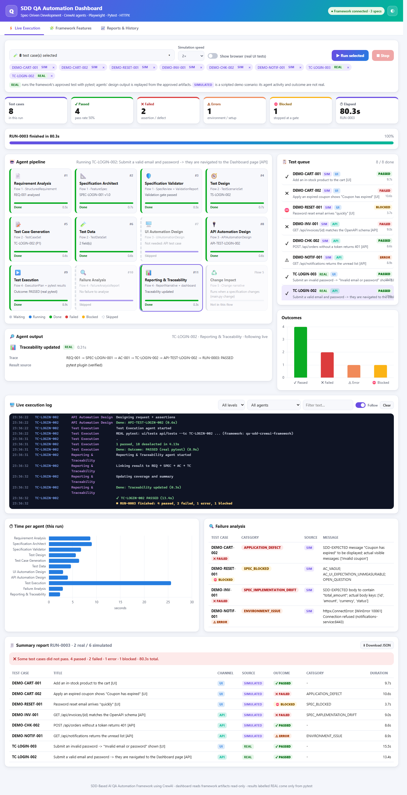

| Agent output: the real generated code of `TC-LOGIN-003` | Agent output: failure analysis |
|---|---|
| 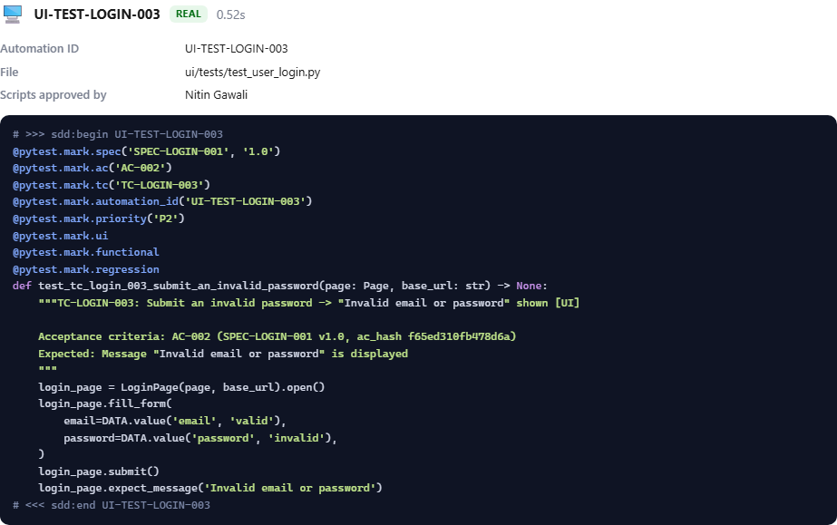 | 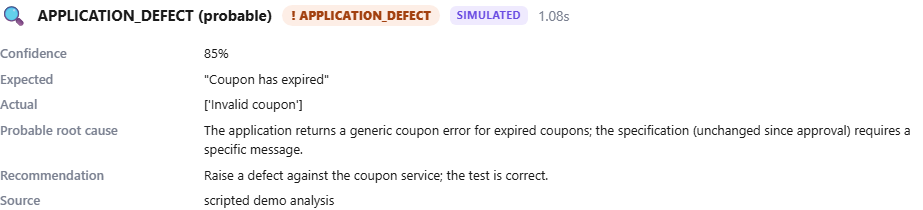 |

The Framework Features tab:

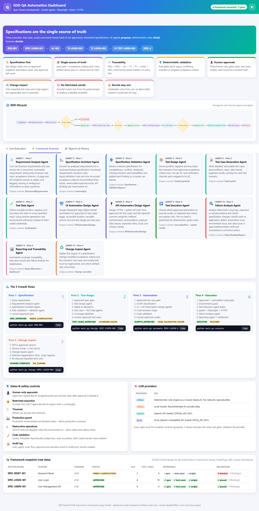

The dashboard only reads the framework's files. Its real pytest runs write results and logs into
`Dashboard-qa-sdd-crewai-framework/runs/` (git-ignored), never into `specifications/` or `output/executions/`.
See [its README](Dashboard-qa-sdd-crewai-framework/README.md) for the API, the layout and a 5-minute demo script.

---

## 17. Change impact and selective regeneration

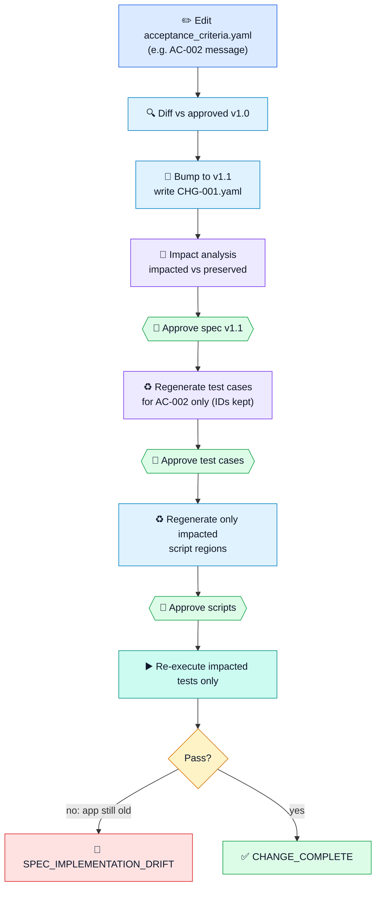

1. Edit `specifications/features/user-login/acceptance_criteria.yaml`, e.g. change the AC-002 message.
2. Run `main.py change SPEC-LOGIN-001`. It diffs the working spec against approved v1.0, bumps to v1.1,
   writes `specifications/changes/CHG-001.yaml` (impacted **and** preserved test cases and scripts) and asks for
   spec approval.
3. Approve, then run `change` again after **each** approval. Only test cases for the changed AC are
   regenerated (IDs kept); only their script regions are regenerated, every other region stays byte-for-byte
   the same; only the impacted test cases are re-executed.
4. The demo app still shows the old message, so the Failure Analysis Agent classifies the failure as
   `SPEC_IMPLEMENTATION_DRIFT`.
5. Set `SDD_DEMO_LOGIN_ERROR` to the new text and run `execute` again. The tests pass.

See [FLOW.md › Flow 5](FLOW.md#flow-5--specification-change-impact) for the full walkthrough.

---

## 18. Safety controls

| Control | How |
|---|---|
| **Human approvals** | human-only, bound to content hashes; approved snapshots are read-only and never overwritten |
| **Restricted execution** | a script runs only if it is approved **and** its region hash is unchanged since approval |
| **Timeouts** | for the whole run and for each test |
| **Production guard** | an environment flagged `production` is blocked unless `--allow-production` is passed |
| **Destructive operations** | `@pytest.mark.destructive` tests are skipped unless the environment or the flag allows them |
| **Code validation** | syntax, forbidden imports and calls (`subprocess`, `eval`, `os.system`, …), hard-coded secrets, trace markers |
| **Secrets** | only in `.env` (git-ignored); masked in the audit log and API logs; test data uses `${env:VAR}` |
| **No fabricated results** | results come only from the pytest plugin; AI analysis is labelled "probable" |

---

## 19. Testing the framework itself

```powershell
$env:LLM_PROVIDER = "offline"
.\.venv\Scripts\python.exe -m pytest tests -p no:cacheprovider -q
```

The 14 unit tests cover requirement parsing, spec validation (ambiguous and invented ACs), OpenAPI binding,
coverage and boundary scenarios, stable IDs under selective regeneration, region merge, code validation,
failure and drift classification, and test data expressions.

---

## 20. Troubleshooting

| Symptom | Cause and fix |
|---|---|
| `BrowserType.launch … Failed to load Chrome DLL` (headed mode only) | The full Chromium build is damaged (often antivirus quarantine of `chrome.dll`). Run `python -m playwright install --force chromium`. |
| `APPROVAL REFUSED` | The content changed since review, the approver name looks like an AI/system, or the previous stage is not approved. |
| `NEEDS_CLARIFICATION` | Open `specifications/features/<feature>/clarification_request.md`, fix the requirement and run `main.py spec REQ-… --regenerate`. |
| `BLOCKED: approved_scripts` | Approve the scripts, or a generated script was edited after approval (region hash mismatch). |
| Groq `413 … tokens per minute` | Free-tier limit. Use a smaller model (`openai/gpt-oss-20b`), a paid tier, Ollama, or `LLM_PROVIDER=offline`. |
| `Task … did not return a valid …` | The LLM reply failed the contract three times. See `output/audit/rejected/`. Try a stronger model or `offline`. |
| Dashboard charts are empty | `dashboard.html` loads Chart.js and Mermaid from a CDN; open it with internet access. |
| Too much CrewAI console output / too little | Set `SDD_CREWAI_VERBOSE=1` to see CrewAI's own panels. |

---

**Further reading:** [FLOW.md](FLOW.md) · [config/agents.yaml](config/agents.yaml) ·
[config/tasks.yaml](config/tasks.yaml) · [specifications/api/openapi.yaml](specifications/api/openapi.yaml)
